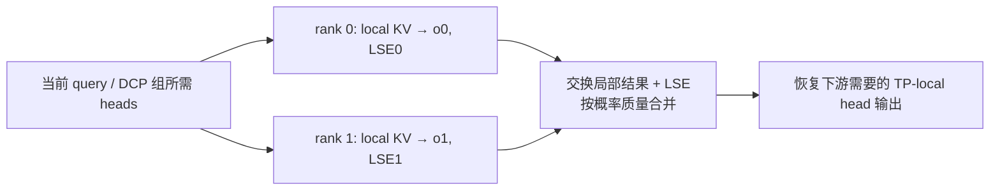

# 04. DCP：分历史 KV，用正确的 softmax 合并局部答案

**简体中文** | [English](../../../en/ai-infra-basic/Parallel_Strategy/04-decode-context-parallelism.md)

## 1. 作用：一个新 query，也能让多卡分担历史读取

Decode 的新 query 行很少，但历史很长。DCP（Decode Context Parallelism）让不同 rank 持有不同历史 KV，并计算同一 query 对各自历史的贡献。尤其在 absorbed MLA 中，TP 能切 query heads，却不一定减少各卡重复的 latent KV；DCP 补上历史维度的切分。



它不是复制多份请求，也不是简单平均局部 attention。下面从单 query 推导这个区别。

## 2. 推导一：直接合并未归一化分子分母

令历史索引按互不重叠的 $`J_r`$ 分组，score 为 $`s_j=qk_j^{\mathsf T}/\sqrt d`$。完整 attention：

```math
o=\frac{\sum_j\exp(s_j)v_j}{\sum_j\exp(s_j)}.
```

用全局最大值 $`m=\max_j s_j`$ 保持数值稳定：

```math
z_r=\sum_{j\in J_r}\exp(s_j-m),\qquad
u_r=\sum_{j\in J_r}\exp(s_j-m)v_j,\qquad
o=\frac{\sum_r u_r}{\sum_r z_r}.
```

旧 [sp_inference_demo.py](./sp_inference_demo.py) 就用类似的全局 max、sum、输出分子规约验证 CP 原理。实际 DCP 还需要缓存地址、query/head 布局和专用 kernel。

## 3. 推导二：kernel 已返回局部归一化结果怎么办

高效 attention kernel 常返回局部结果 $`o_r`$ 和 $`\ell_r`$（log-sum-exp）：

```math
\ell_r=\log\sum_{j\in J_r}\exp(s_j),\qquad
o_r=\frac{\sum_{j\in J_r}\exp(s_j)v_j}{\exp(\ell_r)}.
```

所以全局正确合并是：

```math
\ell=\log\sum_r\exp(\ell_r),\qquad
o=\sum_r\exp(\ell_r-\ell)o_r.
```

每个局部结果的权重是它在全局 softmax 中占据的**概率质量**。

小例子：两个 rank 各有一个历史 value，分别为 $`2`$ 和 $`10`$；其 score 为 $`0`$ 和 $`\log 3`$。局部 softmax 都只有一项，局部输出分别是 $`2`$、$`10`$，但正确答案为：

```math
o=\frac{1\cdot2+3\cdot10}{1+3}=8.
```

直接求和得到 $`12`$，平均得到 $`6`$，都错。实际合并必须核对 LSE 是自然对数还是以 2 为底，并处理全被 mask 的局部分片：其概率质量为零，不能让空片的 NaN 污染结果。

## 4. 缓存地址：逻辑位置与本卡物理行分开

先采用逐 token interleave 的教学模型，DCP degree 为 $`C`$，共享虚拟 slot 为 $`v`$：

```math
\mathrm{owner}(v)=v\bmod C,\qquad
\mathrm{local}(v)=\lfloor v/C\rfloor.
```

| 虚拟 slots | rank 0 的物理行 | rank 1 的物理行 |
|---|---|---|
| 0、1、2、3、4、5 | 0、1、2 对应 0、2、4 | 0、1、2 对应 1、3、5 |

每张卡都看到一致的请求→虚拟 slot 映射，但只写入自己拥有的 slot。物理每页容量为 $`P`$ 时，虚拟页可容纳 $`PC`$ 个 slots；这不是每卡真的多出 $`C`$ 倍显存。

上游 [layout.py](https://github.com/sgl-project/sglang/blob/f2b73d4f9b4e64415b8d775b0f811c7801f1728b/python/sglang/srt/layers/dcp/layout.py) 的 `maybe_dcp_kernel_indices()` 对应逐 slot 筛选；`localize_dcp_indices()` 还支持 block interleave 参数。因此上面只是最小模型，真实 backend 的页粒度、padding 和 sparse 索引必须按实际约定转换。

## 5. SGLang 的实际通信路径

固定上游 [DCP 文档](https://github.com/sgl-project/sglang/blob/f2b73d4f9b4e64415b8d775b0f811c7801f1728b/docs/docs/advanced_features/dcp.mdx) 的 absorbed MLA 主路径可按下列顺序读：

1. 参数解析 DCP group 与 degree，嵌套在所属 Attention TP/DPA 范围内。
2. 按 owner 规则写本地 KV，建立本地 metadata/page table。
3. 让各 rank 获得计算自己历史贡献所需的 query heads。
4. attention kernel 输出局部 normalized output 与 LSE。
5. 交换并合并，恢复普通 TP-local head 布局。

| 实现 | 关键区别 |
|---|---|
| `ag_rs` | query gather，LSE gather，输出 reduce-scatter |
| `a2a` | 打包 output+LSE 做 all-to-all，然后本地合并 |
| `fi_a2a` | 使用 FlashInfer 的特定 MNNVL all-to-all 路径，受硬件域限制 |
| replicated Q projection | 启动时复制支持的 query 投影权重，换取少一次逐层 query gather；增加权重与计算 |

实际代码见 [comm.py](https://github.com/sgl-project/sglang/blob/f2b73d4f9b4e64415b8d775b0f811c7801f1728b/python/sglang/srt/layers/dcp/comm.py)、[metadata.py](https://github.com/sgl-project/sglang/blob/f2b73d4f9b4e64415b8d775b0f811c7801f1728b/python/sglang/srt/layers/dcp/metadata.py)、[planner.py](https://github.com/sgl-project/sglang/blob/f2b73d4f9b4e64415b8d775b0f811c7801f1728b/python/sglang/srt/layers/dcp/planner.py)。不要把本章 all-to-all 说成“将所有原始 KV 重新复制到所有卡”：交换的核心对象是局部答案与归一化信息。

## 6. 内存收益与代价

普通 GQA 单请求的 KV payload 近似为 $`M=2L_{\mathrm{layers}}TH_{\mathrm{KV}}ds`$ 字节。理想均匀 DCP 后，每卡存其中约 $`M/C`$；MLA 必须改用真实 latent cache 宽度计算。

其中层数为 $`L_{\mathrm{layers}}`$，历史长度为 $`T`$，KV head 数为 $`H_{\mathrm{KV}}`$，每 head 宽度为 $`d`$，元素字节数为 $`s`$。下面仅将成本分项列账；不同实现可能重叠计算与访存，不是精确延迟预测。

```math
t_{\mathrm{decode}}\approx
t_{\mathrm{query}}+
\frac{\mathrm{local\ KV\ bytes}}{B_{\mathrm{HBM}}}
+t_{\mathrm{attention}}+t_{\mathrm{merge}}.
```

随着历史变长，分摊 KV 读取可能收益更大；短历史时，新增 collective 和 query 布局成本可能主导。page metadata、复制 query 权重、draft KV、临时输出也会占内存。

DCP 不自动缩小 GDN/KDA 的 request-indexed recurrent state，也不能从一个已验证的 MLA kernel 推断所有 MHA/DSA/NPU kernel 都支持。此本地源码快照尚无完整 DCP 实现；本文的具体 DCP API 全部链接到固定上游，而不是本地伪入口。

## 7. 练习与正确性检查

[数学 demo](./parallelism_math_demo.py) 验证单 token、长历史、大 score、空分片的 LSE 合并；输出应与直接全历史 attention 一致。同时检查 owner/local 索引可逆、每个 slot 恰好有一个 owner。

故障时先查：LSE 对数底、全局 causal position、virtual/physical page 映射、partial head 顺序、请求取消与 slot 复用。继续读 [05：DWDP](./05-dwdp-weight-parallelism.md)。
