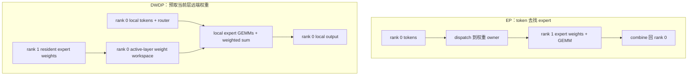
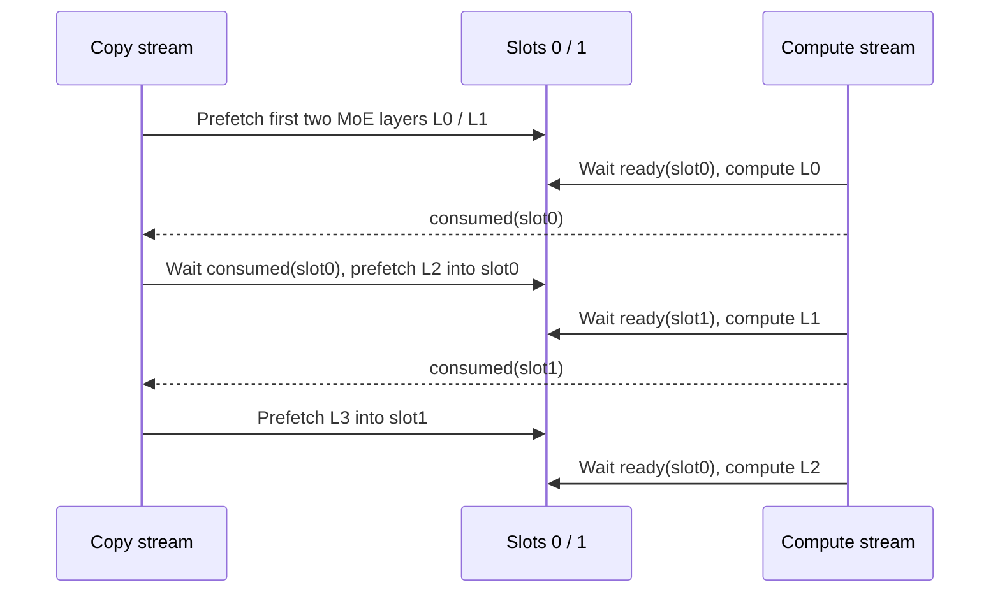

# 05. DWDP：让权重来找 token，而不是每层都搬 token

**简体中文** | [English](../../../en/ai-infra-basic/Parallel_Strategy/05-dwdp-weight-parallelism.md)

## 1. 作用：换一个需要跨卡移动的对象

EP 将 expert 权重放在不同 rank，token 根据路由访问它们。DWDP（Distributed Weight Data Parallelism）保留本地请求，在处理某层前把远端 expert 权重预取到本地工作区，然后本地执行专家计算。

它不是普通 DP：每卡不必永久保存全部层的全部 expert 权重。它也不是把 router 改成只选本地专家；相同路由应得到相同数学结果。固定上游将它主要面向大批 prefill，字段见 [parallel.py](https://github.com/sgl-project/sglang/blob/f2b73d4f9b4e64415b8d775b0f811c7801f1728b/python/sglang/srt/arg_groups/fields/parallel.py)。



## 2. 数学为什么相同

给定 token $`x_t`$、已确定的 top-k expert 集合 $`\mathcal E_t`$ 与权重 $`a_{t,e}`$：

```math
y_t=\sum_{e\in\mathcal E_t}a_{t,e}F_e(x_t;W_e).
```

只要得到的 $`W_e`$、路由、量化参数与计算语义一致，$`F_e`$ 在 token owner 还是 weight owner 上运行，不改变目标公式。跨设备的浮点顺序、kernel/量化差异仍需设定误差容限。

教学例：token A 在 rank 0，输入为 $`2`$，选择专家 0/2，权重为 $`(0.25,0.75)`$；专家函数为 $`F_e(x)=(e+1)x`$。EP 发送一条分支给 rank 1；DWDP 把专家 2 的权重带到 rank 0，两者都得到：

```math
y_A=0.25\cdot2+0.75\cdot6=5.
```

这证明数学可以等价，未证明两条通信路径同样快。

## 3. 什么时候搬权重可能更划算

设一个 rank 每层处理 $`n`$ 个 token，top-k 为 $`k`$，hidden 宽度 $`H`$，元素字节数 $`s`$，远端 assignment 比例 $`\rho`$。忽略去重、padding、scale 和拓扑，只估计其远端 token dispatch+combine 字节：

```math
V_{\mathrm{EP}}\approx 2nk\rho Hs.
```

若该层每个 rank 预取的远端权重总量为 $`W_{\mathrm{remote}}`$：

```math
V_{\mathrm{DWDP}}\approx W_{\mathrm{remote}},\qquad
n_{\mathrm{cross}}\approx\frac{W_{\mathrm{remote}}}{2k\rho Hs}.
```

取教学参数：远端权重 96 MiB、$`H=4096`$、$`s=2`$、$`k=8`$、$`\rho=0.75`$，字节交点为 $`n=1024`$。这只是**单 rank、单层、有效 payload 的估算**：真实 EP 可合并同目的地 token，DWDP 有页对齐、访问与同步成本；网络带宽和重叠程度也不同，字节少不等于更快。

重要区别：固定实现预取规划好的远端 expert 权重范围，并不是根据本批路由只精确取每个命中的小权重片。每步只有少量 decode token 时，仍可能反复搬大量权重，因此不能机械应用到 decode。

若 $`\rho=0`$，EP 没有本估算中的远端 token payload，不存在上述字节交点。

## 4. 源码：owner、映射、预取、消费

本地快照没有 DWDP，以下全部是固定上游入口：

| 源码 | 责任 |
|---|---|
| [dwdp_manager.py](https://github.com/sgl-project/sglang/blob/f2b73d4f9b4e64415b8d775b0f811c7801f1728b/python/sglang/srt/layers/moe/dwdp/dwdp_manager.py) | 收集 MoE 层、建立布局/传输/权重管理器、控制生命周期 |
| [layout.py](https://github.com/sgl-project/sglang/blob/f2b73d4f9b4e64415b8d775b0f811c7801f1728b/python/sglang/srt/layers/moe/dwdp/layout.py) | expert owner 区间、页对齐、复合虚拟地址布局 |
| [transport.py](https://github.com/sgl-project/sglang/blob/f2b73d4f9b4e64415b8d775b0f811c7801f1728b/python/sglang/srt/layers/moe/dwdp/transport.py) | 交换/导入 FABRIC 或 POSIX fd 内存句柄，建立 peer views |
| [weight_buffer.py](https://github.com/sgl-project/sglang/blob/f2b73d4f9b4e64415b8d775b0f811c7801f1728b/python/sglang/srt/layers/moe/dwdp/weight_buffer.py) | 本地常驻权重与远端预取页组成工作层 tensor view，复用工作槽 |
| [weight_manager.py](https://github.com/sgl-project/sglang/blob/f2b73d4f9b4e64415b8d775b0f811c7801f1728b/python/sglang/srt/layers/moe/dwdp/weight_manager.py) | copy stream、双缓冲、ready/consumed events、预取远端 slices |

虚拟地址映射让 GEMM 看见连续的 expert 权重视图，但实际物理页可以来自“本地常驻区 + 远端权重拷贝工作区”。它不意味着远端权重无需传输，也不意味着这套 CUDA/VMM 实现已经在 NPU 上可用。

## 5. 双缓冲为什么要等待两种事件



这里 L0/L1 表示相邻的 **MoE 层次序**，不要求模型 layer id 连续。`prefetch_first_layers()` 先准备前两层；`wait_prefetch()` 保证先传完再算；`record_compute_and_prefetch_next()` 在当前槽消费后预取后面第二个 MoE 层，因为它复用同一槽。

ready 防止读未完成的权重；consumed 防止预取覆盖仍在 GEMM 中使用的权重。仅有两条 stream、没有这两个依赖，可能得到偶发错误。

## 6. 显存与兼容性账本

假设专家总权重均匀常驻分片，工作区使用两个最大层的远端权重槽，则粗略为：

```math
M_{\mathrm{rank}}\approx M_{\mathrm{nonexpert}}
+\frac{W_{\mathrm{expert,all}}}{P}
+2\left(1-\frac1P\right)W_{\mathrm{expert,maxlayer}}
+M_{\mathrm{activation}}+M_{\mathrm{metadata}}.
```

这不是精确分配公式，还要考虑页对齐、scratch、模型差异。它解释了为什么“没有 token A2A”仍会消耗工作区和权重带宽。

上游 [handle_dwdp()](https://github.com/sgl-project/sglang/blob/f2b73d4f9b4e64415b8d775b0f811c7801f1728b/python/sglang/srt/arg_groups/parallel_hook.py) 要求 DWDP degree 与 TP world size 相同，并选择相应 DPA/EP/LM Head 布局；该版本拒绝 EPLB 动态迁移、PP、speculative 和 two-batch overlap 等组合。它允许 null/prefill 服务形态，但对 null 下 decode 每步重新取远端权重明确给出性能提示。

## 7. 练习

[数学 demo](./parallelism_math_demo.py) 从同一组 token/routes 分别模拟“发送激活”和“取权重后本地算”，验证输出一致，并计算上述字节交点。

如果每次 weight fetch 的成本近似固定，扩大 prefill batch 为什么能更好摊销？为什么一张卡的权重预取慢，也可能让整体 serving 的尾延迟上升？继续读 [06：组合并行](./06-parallel-topology-and-pd-composition.md)。
