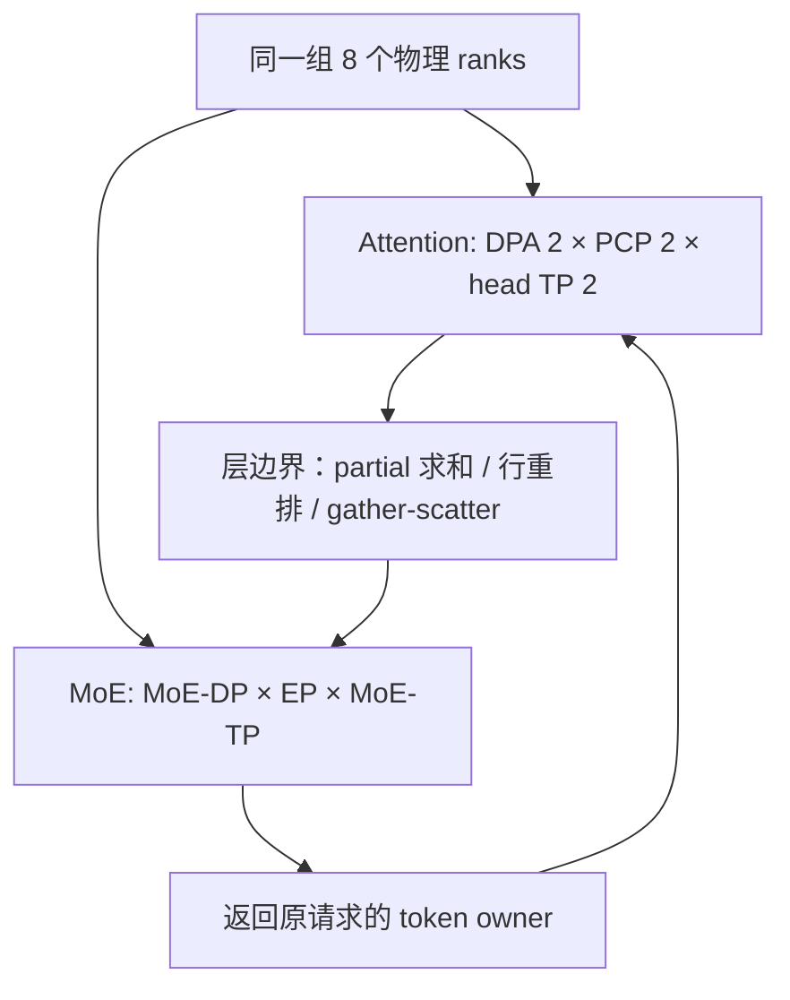
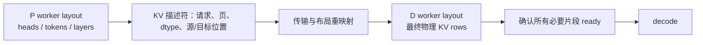

# 06. 组合并行：rank 网格、阶段交接与不同布局

**简体中文** | [English](../../../en/ai-infra-basic/Parallel_Strategy/06-parallel-topology-and-pd-composition.md)

## 1. 先数物理 rank，再给它们分配逻辑身份

同一个 rank 可以同时属于 Attention TP、CP、DPA、MoE TP、EP、MoE DP 和 PP group。它们不必是彼此独立的硬件维度，因此不能把所有参数直接相乘。

对一个无外部 DP/PP 的教学模型 world，设 $`T_w`$ 为已有 rank 数，DPA、PCP、Attention TP degree 分别为 $`D,C,A`$。采用此处明确规定的编号：

```math
T_w=DCA,\qquad p=(dC+c)A+a.
```

这是用于读表的布局，具体程序以其 `initialize_model_parallel()` 为准。例：$`T_w=8,D=2,C=2,A=2`$：

| world rank | DPA | PCP | Attention TP | Attention TP group |
|---|---|---|---|---|
| 0、1 | 0 | 0 | 0、1 | 0、1 |
| 2、3 | 0 | 1 | 0、1 | 2、3 |
| 4、5 | 1 | 0 | 0、1 | 4、5 |
| 6、7 | 1 | 1 | 0、1 | 6、7 |

在这个教学编号下，CP groups 是 0/2、1/3、4/6、5/7；DPA0 与 DPA1 各负责自己的请求。MoE 完全可以将同样八张卡解释为另一套专家布局。



本地具体 group 示例见 [TP/DP/EP 源码篇](../../sglang-source-reading/05-layer-communication/02-tp-dp-ep-sharding-and-ascend-npu.md)，不要用上表覆盖其中明确给定的其他编号。

## 2. DCP 通常复用既有 Attention TP ranks

改用另一个例子：已有 8 ranks、DPA 为 2、每组 Attention TP 为 4，DCP 为 2。DCP 可以在每个四卡 Attention 组内部建立子组：

| DPA owner | 已有 Attention ranks | 示意 DCP 子组 |
|---|---|---|
| 0 | 0、1、2、3 | 0/1 与 2/3 |
| 1 | 4、5、6、7 | 4/5 与 6/7 |

总卡数仍为 8。DCP group 的确切 head 组织由实现决定，但必须留在同一请求归属域内。必要的包含关系是：

```math
A=T_w/D,\qquad A\bmod C_{\mathrm{DCP}}=0.
```

这不是把 DCP 再额外乘一次卡数。也不要因为 PCP 和 DCP 作用于不同阶段就认为同实例任意组合都可用：固定上游 [parallel_hook.py](https://github.com/sgl-project/sglang/blob/f2b73d4f9b4e64415b8d775b0f811c7801f1728b/python/sglang/srt/arg_groups/parallel_hook.py) 明确拒绝同时启用 prefill CP 与大于 1 的 DCP。

## 3. MoE 的三个维度分别回答什么

在可整除、按该拓扑分解的情形：

```math
T_w=D_{\mathrm{MoE}}E_{\mathrm{EP}}A_{\mathrm{MoE\,TP}}.
```

- EP 决定某个逻辑 expert 放在哪组 rank。
- MoE TP 决定一个 expert 内部矩阵怎样切分。
- MoE DP 决定同一套专家分布有几份数据副本。

例如专家矩阵大到单卡放不下时，只增加 EP 不会自动切开单个 expert；需要看 MoE TP。热点 expert 复制/EPLB 又会改变 logical→physical expert 映射，不能只按静态连续 expert 区间判断目的地。

## 4. P/D 使用不同并行度时，怎样保持 KV 完整

PD 是不同实例间的请求交接，不是单实例的另一个 tensor 轴。先看不含 DCP 的 GQA 教学例：8 个 KV heads，P-TP=2、D-TP=4。

| P source | 持有 KV heads | D destination |
|---|---|---|
| P0 | 0、1、2、3 | D0 接 0/1，D1 接 2/3 |
| P1 | 4、5、6、7 | D2 接 4/5，D3 接 6/7 |

这里不仅要传 bytes，还要重分 head shard、dtype、页与请求 slot。若 D 端再按 token 做 DCP，还要增加 token owner 变换；MLA latent KV 不应直接照用 GQA head 分片表。



一个正确映射应让每个需要的目标 KV 元素来自正确的源元素；复制源可以只选一份，分片源则必须齐全。不能仅比较两端 buffer 总字节数。

对应源码为本地 [disaggregation/mooncake/conn.py](../../../../python/sglang/srt/disaggregation/mooncake/conn.py)、上游 [DCP pack](https://github.com/sgl-project/sglang/blob/f2b73d4f9b4e64415b8d775b0f811c7801f1728b/python/sglang/srt/disaggregation/common/dcp_pack.py)；后者仅用于受支持的配置，不代表所有 P/D degree 和 cache format 任意互通。完整协议见 [KV Transfer](../KV_Transfer/README.md)。

## 5. PP 是另一条时间流水：不要只讨论切几层

推理 PP 把层放在不同 stages。处理 $`M`$ 个独立 microbatches、$`S`$ 个等耗时 stages 的理想前向流水占用率可估计为：

```math
\eta\approx\frac{M}{M+S-1}.
```

这只是忽略通信与不均衡的前向近似，不是自回归单请求的延迟公式。Decode 的下一 token 依赖上一轮最终输出；prefill chunk 的不同历史长度也会改变耗时。上游 [PP 文档](https://github.com/sgl-project/sglang/blob/f2b73d4f9b4e64415b8d775b0f811c7801f1728b/docs/docs/advanced_features/pipeline_parallelism.mdx) 继续讨论 async microbatch 和 dynamic chunking。训练的 1F1B 调度不能直接当作推理中已经采用的协议。

## 6. 一张组合实验记录表

| 要记录 | 为什么 |
|---|---|
| 物理 rank/device/node/NIC 映射 | 同样的逻辑组可能跨不同慢链路 |
| DPA、PCP、DCP、Attention TP groups | 保证请求和历史边界一致 |
| MoE DP/EP/TP、expert location | 保证路由、参数 shard 和返回 owner 对齐 |
| 每个边界的 shape + partial/replica + token id | shape 相同也可能求和语义不同 |
| P/D KV 格式与传输完成协议 | 避免错误重排和过早调度 |
| 模型/backend/版本与实际校验约束 | 数学组合不等于实现支持 |

运行 [数学 demo](./parallelism_math_demo.py) 的 topology 与 P/D head-remap 部分；练习画出两个 DPA 组内的 DCP 子组，检查有没有跨请求域。继续读 [07](./07-encoder-dp-and-elastic-ep.md)。
