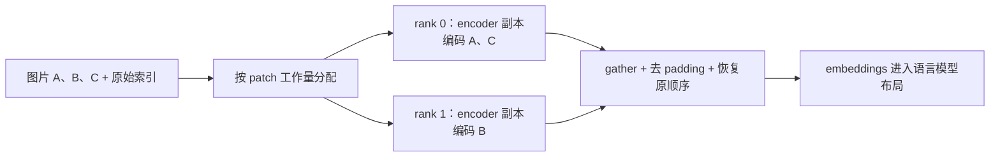
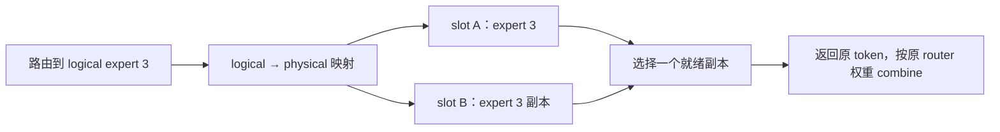
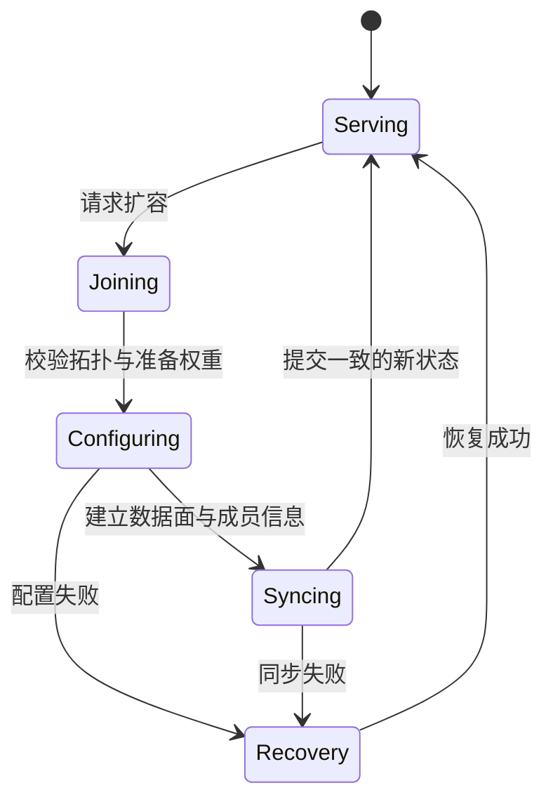

# 07. Encoder DP 与弹性 EP：模块并行和运行时重配置

**简体中文** | [English](../../../en/ai-infra-basic/Parallel_Strategy/07-encoder-dp-and-elastic-ep.md)

## 1. Encoder DP 解决什么问题

图片/视频先进入 vision encoder，得到 embeddings，再插入语言模型输入。如果每个语言模型 TP rank 都重复编码全部图片，会浪费计算；改成 encoder TP，又可能让小矩阵频繁通信。

Encoder DP 让各 rank 持有 encoder 副本，分担**独立图片或视频片段**，再收集 embeddings。语言模型仍然可以采用 TP。



## 2. 数学原理与工作量

设 encoder 为 $`E`$，图片为 $`I_i`$。不同样本之间没有交互时：

```math
E([I_0,I_1,\ldots])=[E(I_0),E(I_1),\ldots].
```

因此可分配样本索引，独立编码后恢复顺序。这不是把一张图片内部的 patch 任意拆开：ViT self-attention 通常需要图片内部 patch 互相可见。视频的时空位置和窗口规则也必须保留。

设任务成本为 $`w_i`$，rank 的任务集为 $`\mathcal I_r`$：

```math
t_{\mathrm{encode}}\approx\max_r\sum_{i\in\mathcal I_r}w_i
+t_{\mathrm{gather}}+t_{\mathrm{reorder}}.
```

工作量 $`[9,8,1,1]`$ 按输入顺序平分得到 $`17,2`$；把大图分开可得到 $`10,9`$。这里是教学单位，不是源码的延迟预测；patch 数也不能完整描述 attention 成本。

## 3. 源码与数据流

本地 [qwen3_vl.py](../../../../python/sglang/srt/models/qwen3_vl.py) 中，`mm_enable_dp_encoder` 影响 vision TP 设置；`get_image_feature()` / `get_video_feature()` 选择编码路径。

固定上游 [mm_utils.py](https://github.com/sgl-project/sglang/blob/f2b73d4f9b4e64415b8d775b0f811c7801f1728b/python/sglang/srt/multimodal/mm_utils.py)：

| 入口 | 数据如何变化 |
|---|---|
| `run_dp_sharded_vision_model` | 规则 chunks 按 rank 切分，补齐后编码，gather 后裁掉 padding |
| `run_dp_sharded_mrope_vision_model` | 根据 grid/位置元数据分配可变大小输入，保留重排信息 |
| 输出 `all_gather` 与重排 | 收集补齐后的 embeddings，根据长度和索引恢复顺序 |
| `run_dp_presharded_mrope_vision_model` | 已经预分片的输入路径，不能重复切分 |

图片索引、patch/grid、位置编码、输出长度、padding 和排列必须一起检查。总行数相同，仍可能把图片 A 的 embedding 放进图片 B 的占位符。具体模型路径以调用点为准。

## 4. EPLB：专家位置变化，函数不变

EP 决定专家分布；EPLB 根据负载调整位置或冗余副本。一个 logical expert 的多个 physical slots 应实现同一个函数：

```math
y_t=\sum_{e\in\mathcal E_t}g_{t,e}f_e(x_t).
```

路由到专家 3 后，可选择它的一个就绪副本。**不能因为有两份副本，就把同一个路由贡献加两次。**



每个仍可能被调用的专家至少需要一个就绪副本：

```math
\forall e,\qquad
\sum_p\mathbf{1}[\text{slot }p\text{ is a ready copy of }e]\geq 1.
```

这是教学正确性条件，不是 EPLB 的完整优化目标。每个 rank 专家数量相等，也不代表热点负载均衡。参见本地 [eplb](../../../../python/sglang/srt/eplb/) 和 [EP 通信课](../Communication/04-moe-deepep-and-zbal.md)。

## 5. Elastic EP：不只是把 EP 数字改大

新 rank 加入时，权重、expert 映射、通信成员、Attention DP 元数据和可执行状态需要一致。混用旧 group、旧映射和新路由可能卡住 collective，也可能算错结果。



这是职责图，不是源码全部状态名。固定上游 [elastic_ep.py](https://github.com/sgl-project/sglang/blob/f2b73d4f9b4e64415b8d775b0f811c7801f1728b/python/sglang/srt/elastic_ep/elastic_ep.py) 依次读 `validate_scale_cohort_topology`、`update_dp_attention_for_elastic_ep`、`try_admit_scale_ranks` 和提交/恢复路径。

[topology.py](https://github.com/sgl-project/sglang/blob/f2b73d4f9b4e64415b8d775b0f811c7801f1728b/python/sglang/srt/elastic_ep/topology.py) 固定 Attention replica 的物理宽度，再把 EP ranks 映射到 DPA：

```math
R_{\mathrm{attn}}=A_{\mathrm{TP}}C_{\mathrm{CP}},\qquad
D_{\mathrm{attn}}=E_{\mathrm{physical}}/R_{\mathrm{attn}}.
```

要求整除，新 cohort 的 Attention TP/CP 拓扑必须匹配原 cohort；一个 attention replica 的**全部成员**健康才算健康。这是该实现的约束，不是所有弹性系统的通用公式。

## 6. 检查理解

- Encoder DP：embeddings 是否回到正确图片占位符？没有任务的 rank 是否仍参与必要的 gather？
- EPLB：增加专家副本为何不改变单 token 的 top-k 数学结果？
- Elastic EP：新 rank 何时能接 token？扩容失败时哪份映射有效？

[数学 demo](./parallelism_math_demo.py) 演示 encoder 负载与专家副本；图像/视频生成继续读 [08](./08-diffusion-parallelism.md)。
