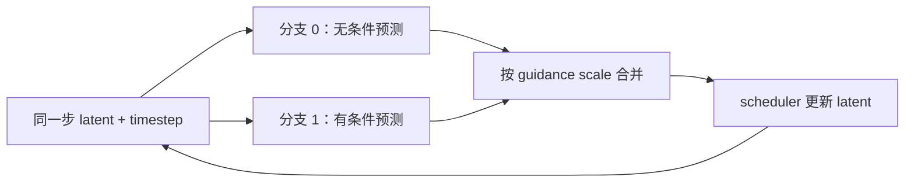
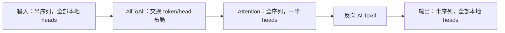
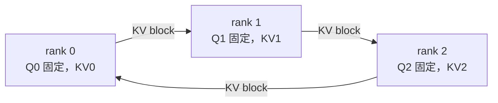

# 08. Diffusion 并行：CFG、Ulysses、Ring 和 KV-gather

**简体中文** | [English](../../../en/ai-infra-basic/Parallel_Strategy/08-diffusion-parallelism.md)

本章是图像/视频生成扩展。SGLang Diffusion 位于 `multimodal_gen`，与自回归语言模型的 SRT PCP/DCP 使用不同执行流程和参数体系。共同点是张量切分和精确 softmax；“SP”这个名字不能证明两边是同一实现。

## 1. CFG：把同一步的条件分支并行算

普通双分支 classifier-free guidance 同时需要有条件预测和无条件预测：

```math
\epsilon_{\mathrm{guided}}
=\epsilon_{\mathrm{uncond}}
+g(\epsilon_{\mathrm{cond}}-\epsilon_{\mathrm{uncond}}).
```

两个分支使用同一步 latent 与时间步，条件输入不同，可以先独立执行 DiT，再合并。若无条件预测为 2、有条件为 5、guidance scale 为 3，最终为 11。不能用“每张卡各做一半 denoise steps”代替：下一步 latent 依赖本步合并结果。



理想情况下把两次分支计算的时间变成一次加通信；没有真实双分支的模型不能仅靠打开 CFG 并行获得这种收益。参见固定源码 [cfg_parallel_utils.py](https://github.com/sgl-project/sglang/blob/f2b73d4f9b4e64415b8d775b0f811c7801f1728b/python/sglang/multimodal_gen/runtime/distributed/cfg_parallel_utils.py)。

## 2. Ulysses：把“分 token”暂时变成“分 head”

假设普通 MHA、自注意力各 head 独立、序列与 head 数均可整除。两张卡最初各持半段 token、全部本地 heads。AllToAll 将每段的某部分 heads 发给对方，使每张卡拥有完整序列、较少 heads；各自 attention 完成后，再反向 AllToAll。



设 TP、Ulysses、Ring degree 为 $`T,U,R`$，batch/序列/head/head-dim 为 $`B,S,H,d`$。一次 attention 的逻辑 shape 变化：

```math
[B,S/(UR),H/T,d]
\xrightarrow{\mathrm{AllToAll}}
[B,S/R,H/(TU),d]
\xrightarrow{\mathrm{RingAttention}}
[B,S/R,H/(TU),d]
\xrightarrow{\mathrm{AllToAll}}
[B,S/(UR),H/T,d].
```

Ulysses 是布局置换，不改变 attention 公式；TP 则切投影权重。两者都碰到 head 维，但先后作用于不同层次。GQA、复制的 text 前缀和不等长输入需要专门路径，不能直接套最简单的 MHA shape。

## 3. Ring：query 不动，KV 逐站经过

每张卡保留自己的 query 行，KV 块沿环传递。每经过一块，更新本地 attention 输出和归一化信息；经过所有相关 KV 后得到完整结果。



关键不是把每块 softmax 的输出相加。设两块已归一化输出和自然对数 LSE 为 $`(o_a,\ell_a),(o_b,\ell_b)`$：

```math
\ell=\log(e^{\ell_a}+e^{\ell_b}),\qquad
o=e^{\ell_a-\ell}o_a+e^{\ell_b-\ell}o_b.
```

不断应用这个精确归并，就能边接收边计算；稳定实现先减最大 LSE。它与 [DCP 的 softmax 推导](./04-decode-context-parallelism.md) 同源，但 Ring 在这里处理 DiT attention query 行，不是 SRT 的 decode cache 协议。

同一 Ring group 内应是**相同 heads、不同 token 行**。Ring 不增加 head 整除约束，但需要 kernel 暴露 LSE 并正确处理 mask。图像/视频 attention 通常不是语言模型的三角 causal mask；不能把 PCP zigzag 的负载公式直接搬过来。

## 4. KV-gather：用全量临时 KV 换更直接的计算

另一种办法是每层把 KV AllGather 到本地，然后 local Q 对 full KV 做 attention。它与 Ring 解决同一个“如何看到远端 KV”问题，因此在同一层相同布局位置是**替代方案**。

| 路径 | 每 rank 的核心行为 | 主要代价 |
|---|---|---|
| Ulysses | sequence/head 布局交换 | 两次逻辑 AllToAll，需要 head 可分 |
| Ring | Q 不动、KV 轮转、在线归并 | 多次邻居通信与 LSE merge，可与计算重叠 |
| KV-gather | 收齐 KV 后做 local-Q attention | 临时保存全量 KV，较大通信 burst |
| TP | 投影和输出矩阵分片 | 权重分摊，层内 collective |
| DP | 多个完整 engine 副本处理不同请求 | 请求吞吐，副本之间无 attention collective |

## 5. 实现与组合约束

固定上游源码入口：

| 源码 | 重点 |
|---|---|
| [attention/layer.py](https://github.com/sgl-project/sglang/blob/f2b73d4f9b4e64415b8d775b0f811c7801f1728b/python/sglang/multimodal_gen/runtime/layers/attention/layer.py) | `USPAttention` 选择 Ulysses、Ring、KV-gather；检查 `supports_ring_rotation()` |
| [distributed/parallel_state.py](https://github.com/sgl-project/sglang/blob/f2b73d4f9b4e64415b8d775b0f811c7801f1728b/python/sglang/multimodal_gen/runtime/distributed/parallel_state.py) | 各组如何从物理 ranks 构建 |
| [官方 parallelism 文档](https://github.com/sgl-project/sglang/blob/f2b73d4f9b4e64415b8d775b0f811c7801f1728b/docs/docs/sglang-diffusion/parallelism.mdx) | 参数组合与模型/backend 限制 |
| [encoder_parallel 文档](https://github.com/sgl-project/sglang/blob/f2b73d4f9b4e64415b8d775b0f811c7801f1728b/docs/docs/sglang-diffusion/encoder_parallel.mdx) | Diffusion encoder 的 fold/dp/replicate，区别于 SRT vision encoder 开关 |

对 Ring 路径、独立 group 网格，单副本设备数示意为：

```math
N_{\mathrm{replica}}=F_{\mathrm{CFG}}TUR,\qquad
C_{\mathrm{SP}}=UR,\qquad
H\bmod T=0,\qquad (H/T)\bmod U=0.
```

外部 DP 再复制整个 engine；以启动器的参数校验为准。假设 $`H=56,T=4,U=4`$，虽然总 head 数可被 Ulysses degree 整除，TP 后每 rank 只有 14 heads，仍不能再平均分给四个 Ulysses ranks。

Ring 路径还需序列与 packing 对齐满足要求。固定版本的 generic varlen `USPAttention`、legacy stacked-QKV `UlyssesAttention` 有 Ring 限制；不能因为其他路径支持就当作所有模型可用。NPU 同样应核对具体 backend，不能把 CUDA transport 的行为当作 HCCL 支持证明。

## 6. 小练习与验证

[数学 demo](./parallelism_math_demo.py) 用小矩阵模拟 Ulysses 的 token/head 重排与恢复，对比原始 attention，并验证 CFG 数值。它不执行真实通信。

手动画出两张卡、四个 tokens、两个 heads 的分配；检查交换后每个 head 是否看见所有合法 tokens，再解释为什么输出交换必须是输入交换的逆。实际性能要再测通信量、显存峰值、每步延迟与并发吞吐，不能仅由 degree 大小判断。
