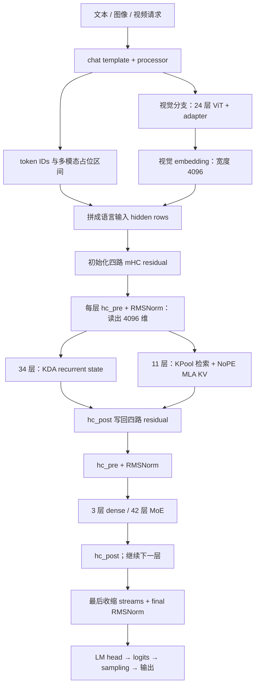
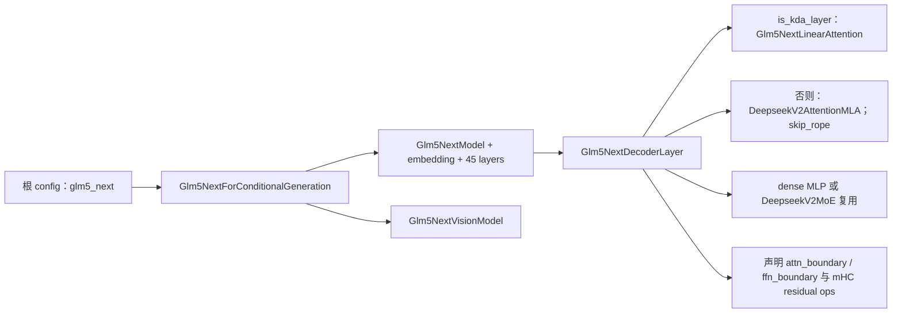
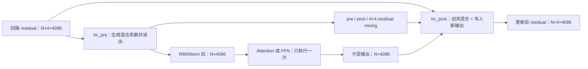
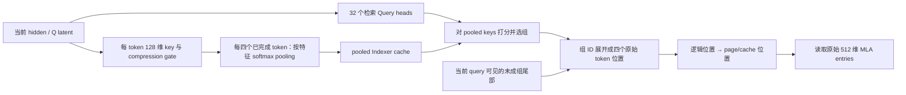
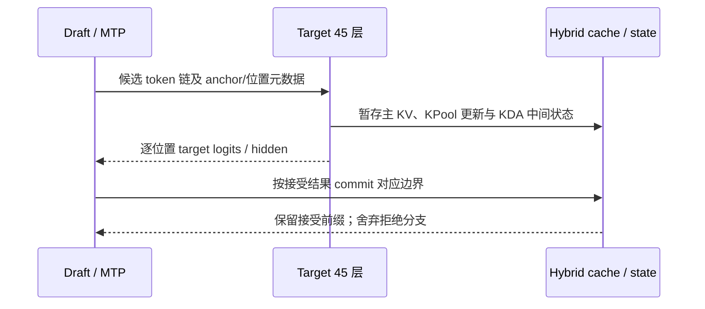

# 端到端样例：GLM-5.3-Flash 的 Hybrid KDA、NoPE 稀疏 MLA、mHC 与多模态执行链

**简体中文** | [English](../../../../en/sglang-ascend-npu/source-code-walkthrough/examples/03-glm-5.3-flash-end-to-end.md)

这篇沿用 [GLM-4.7-Flash](./00-glm-4.7-flash-end-to-end.md) 和 [GLM-5.2](./02-glm-5.2-end-to-end.md) 的“配置 → 对象 → 权重 → 张量 → cache → 一轮生成”阅读方法。**GLM-5.3-Flash 不是 GLM-5.2 的缩小版，也不是把所有层都替换成线性 Attention。** 它同时引入三条变化：

1. 45 层文本主干交错使用 34 个 KDA 层和 11 个 DSA/MLA 层；Attention 类型与 dense/MoE 类型是两个独立维度。
2. 四路 mHC 改变 residual 的组织方式，但 Attention/FFN 的输入宽度仍为 4096。
3. 视觉编码器把图像/视频变成语言 hidden rows；生成过程同时维护 MLA KV、KPool 检索缓存和 KDA recurrent state。

> **版本与平台边界：** 仓内被讲解的 SGLang 源码快照尚无 `models/glm5_next.py`。本讲新增模型的符号均链接到固定上游 revision，不伪装成本地已有文件；也不更新仓内运行时代码。上游模型支持、Ascend 算子存在、具体 NPU 组合实测通过，是三种不同证据。本讲完成配置/源码/CPU 数学验证，不声称已经在 GPU/NPU 上运行完整模型。

---

## 1. 固定阅读基线与资料来源

### 1.1 本讲固定什么、不固定什么

| 对象 | 固定基线 |
|---|---|
| 模型配置 | `zai-org/GLM-5.3-Flash`，revision `46a050bec13002ad29ee795c16e61cf4fa3c4a9c` |
| 上游源码 | `sgl-project/sglang`，commit `92580581da6fc8542a997a00c1a8b71b03497680` |
| 仓内通用流程参考 | 教程开始编写时的仓内 commit `936bdf37c900d7854c57521d832e39df633a5fcb` |
| 核验日期 | 2026-10-16 |
| 张量教学基线 | TP=8、PP=1、EP=1；关闭 Attention DP、CP、speculation 与 graph |
| dtype 基线 | checkpoint 原生 FP8 混合权重；activation 使用配置中的 BF16，MLA KV 先按 BF16 解释 |
| 输入 | 先纯文本、无 prefix 命中；再增加图像、缓存命中和 MTP |

TP=8 是为了手算矩阵，不是最优部署建议。FP8 checkpoint 有 BF16/FP32 例外模块，不能把所有权重一律当作一字节；也不能把 FP8 权重与 FP8 KV cache 当作同一个选项。

一手资料：

- [官方模型卡](https://huggingface.co/zai-org/GLM-5.3-Flash/blob/46a050bec13002ad29ee795c16e61cf4fa3c4a9c/README.md)、[固定 config.json](https://huggingface.co/zai-org/GLM-5.3-Flash/blob/46a050bec13002ad29ee795c16e61cf4fa3c4a9c/config.json)：模型身份、参数与层列表。
- [固定 SGLang cookbook](https://github.com/sgl-project/sglang/blob/92580581da6fc8542a997a00c1a8b71b03497680/docs/cookbook/autoregressive/GLM/GLM-5.3-Flash.mdx)：平台、backend、cache dtype 与部署限制。其支持信息以该 revision 为准，不推广到所有设备。
- [固定模型实现](https://github.com/sgl-project/sglang/blob/92580581da6fc8542a997a00c1a8b71b03497680/python/sglang/srt/models/glm5_next.py)、[配置适配器](https://github.com/sgl-project/sglang/blob/92580581da6fc8542a997a00c1a8b71b03497680/python/sglang/srt/configs/glm5_next.py)：本讲调用链的主要依据。
- [GLM-5.3-Flash 支持合入记录](https://github.com/sgl-project/sglang/pull/36507)：解释为什么旧快照里找不到入口。GLM-5 原论文不是 Flash 所有新增细节的替代来源。

### 1.2 已有数学原理不再整篇重复

| 概念 | 本仓库前置教程 | 本讲新增的重点 |
|---|---|---|
| MLA | [低秩压缩与矩阵吸收](../../../ai-infra-basic/Model_Architecture/04-multi-head-latent-attention.md) | NoPE、512 维 cache、TP=8 的投影 shape |
| DSA | [稀疏 Attention](../../../ai-infra-basic/Model_Architecture/07-deepseek-sparse-attention.md) | KPool 的四合一检索键、tail 与组 ID 展开 |
| KDA | [Kimi Delta Attention](../../../ai-infra-basic/Model_Architecture/09-kimi-delta-attention.md) | 64 heads、128 维、safe gate 与 GLM 的输出门 |
| GDN | [预测 value 与状态更新](../../../ai-infra-basic/Gated_Delta_Network/01-gdn-math-and-state.md) | 为什么 KDA 不能直接照搬 GDN 的标量衰减/输出门 |
| MoE | [路由与专家执行](../../../ai-infra-basic/Model_Architecture/03-sparse-moe-routing.md) | 288 选 8、shared expert、clamped SwiGLU |
| DP Attention | [行所有权与通信](../../../ai-infra-basic/Parallel_Strategy/01-dp-attention-principles.md) | mHC streams/sidecars 也必须跟随同一 token 行映射 |
| Speculation | [Speculative Decoding](../../../ai-infra-basic/Speculative_Decoding/README.md) | MTP 与 hybrid-state commit/rollback |

---

## 2. 配置指纹：先确认读的是 Flash，而不是 GLM-5.3

### 2.1 根配置与 text_config 分开读

| 字段位置 | 固定值 | 意义 |
|---|---|---|
| 根 `architectures` | `Glm5NextForConditionalGeneration` | 多模态 wrapper，不是 `GlmMoeDsaForCausalLM` |
| 根 `model_type` | `glm5_next` | Transformers/config/processor 识别依据 |
| 官方模型卡规模 | 约 320B total / 18B active | 总参数与每 token 激活参数不同；不能由 active 数直接估算权重常驻显存 |
| `text_config.hidden_size` | 4096 | Attention/FFN 的逻辑输入宽度 |
| `num_hidden_layers` | 45 | target 层，不包括额外 MTP 层 |
| `vocab_size` | 154880 | token embedding 与 LM head 词表 |
| `linear_attn_config` | 64 heads、head dim 128、conv kernel 4 | KDA 参数，不能用顶层 `head_dim=0` 替代 |
| `q_lora_rank` / `kv_lora_rank` | 1536 / 512 | MLA 的 Q/KV latent 维度 |
| `num_attention_heads` | 64 | MLA query heads，和 KDA 的 64 heads 恰好同数，但宽度不同 |
| `qk_nope_head_dim` / `qk_rope_head_dim` | 256 / 0 | 文本 MLA 没有 RoPE 子向量 |
| `v_head_dim` | 256 | 显式恢复 V 时每 head 的宽度 |
| `index_n_heads` / `index_head_dim` | 32 / 128 | replicated Indexer 的 query heads/维度 |
| `index_kpool` / `index_topk` | 4 / 2048 | 每组四个 token；历史主 token 预算，不是 2048 个池化组 |
| `index_kpool_compress` / `index_kpool_always_select_tail` | true / true | 学习压缩检索键，并保留未成组尾部 |
| `mhc` / `hc_mult` | true / 4 | 四路 residual streams |
| `hc_sinkhorn_iters` / `hc_eps` | 20 / $`10^{-6}`$ | 残差混合矩阵的约束与稳定项 |
| `first_k_dense_replace` / `intermediate_size` | 3 / 12288 | 前三层使用 dense MLP |
| `n_routed_experts` / `num_experts_per_tok` | 288 / 8 | 每个 sparse layer 的专家库/激活数 |
| `n_shared_experts` / `moe_intermediate_size` | 1 / 2048 | 始终计算的 shared expert / 单专家宽度 |
| `routed_scaling_factor` / `swiglu_limit` | 2.5 / 10.0 | routed 输出缩放 / 激活前裁剪 |
| `num_nextn_predict_layers` | 1 | checkpoint 的 MTP block 数，不等于每轮只能 draft 一个 token |
| `max_position_embeddings` | 1048576 | 配置上限，不保证给定设备容量/后端可运行到此长度 |

原生 `quantization_config` 指定 FP8 E4M3、动态 activation、权重 block shape $`[128,128]`$，同时列出大量不转换模块。`dtype=bfloat16` 与 FP8 quantization 并不矛盾：前者不是“所有序列化 tensor 都是 BF16”的声明。

### 2.2 两条互相独立的层类型轴

| target layer ID（从 0 开始） | Attention | FFN |
|---|---|---|
| 0、1、2 | KDA | dense SwiGLU |
| 3 | DSA + NoPE MLA | sparse MoE |
| 4、5、6 | KDA | sparse MoE |
| 7 | DSA + NoPE MLA | sparse MoE |
| 后续重复至 43 | 每四层前三层 KDA、第四层 DSA | sparse MoE |
| 44 | KDA | sparse MoE |

因此共有 34 个 KDA、11 个 DSA 层，3 个 dense MLP、42 个 MoE 层。DSA 层 ID 为：

```math
\mathcal{L}_{\mathrm{DSA}}=\{3,7,11,15,19,23,27,31,35,39,43\}
```

不应把 backend 名字里的 `full_attn_layers` 理解成“这些层一定是稠密全历史 Attention”。在 hybrid wrapper 中，它表示**非 recurrent 的一侧**；本模型该侧实际仍是 DSA 稀疏 MLA。

### 2.3 全模型数据流



### 2.4 这些组件分别解决什么问题？

| 组件 | 希望降低的成本 / 解决的问题 | 付出的代价或边界 |
|---|---|---|
| KDA | 不在每个层、每个 decode step 重读全历史 KV；把历史写入固定大小的状态 | 有限状态不是可随机访问的全部原始历史；需要时序依赖和正确的 state carry |
| 稀疏 MLA | 保留对历史 token 的显式读取，同时压缩每 token KV，并限制主 Attention 读取的位置数 | 检索有额外成本；未选中的位置不参与该次主 Attention |
| KPool | Indexer 不必对每个历史 token 都维护一个独立的完整检索条目 | 一组共享粗粒度检索决策；选中后仍需读取四个原始 MLA 条目 |
| mHC | 在多路 residual 间提供受约束的动态信息通道 | 增加 residual activation、系数投影与混合成本，不是免费扩宽所有模块 |
| MoE | 用大量总参数增加专家容量，而每 token 只执行部分 routed experts | 权重仍须存放；引入路由、负载均衡与可能的跨卡 dispatch |

因此 hybrid 是两种历史访问方式互补，而不是声称 KDA 与稀疏 MLA 完全等价。mHC 的 Sinkhorn 约束作用在旧 residual 的混合矩阵上，也不能直接推成“包含所有门和子层的整张网络永不放大信号”。这些是从计算结构得出的机制解释，不是本任务重新训练得到的效果归因。

---

## 3. 源码地图与初始化：从 config 走到可执行对象

### 3.1 当前入口不再是 GLM-5.2 的简单子类

| 问题 | 固定上游文件 / 符号 |
|---|---|
| 配置适配、KDA 层列表 | [configs/glm5_next.py](https://github.com/sgl-project/sglang/blob/92580581da6fc8542a997a00c1a8b71b03497680/python/sglang/srt/configs/glm5_next.py)；`Glm5NextTextConfig.is_kda_layer()` |
| 多模态 wrapper、文本主干、decoder、KDA 投影、视觉模块 | [models/glm5_next.py](https://github.com/sgl-project/sglang/blob/92580581da6fc8542a997a00c1a8b71b03497680/python/sglang/srt/models/glm5_next.py) |
| KDA vs DSA 按 layer 分派 | [hybrid_linear_attn_backend.py](https://github.com/sgl-project/sglang/blob/92580581da6fc8542a997a00c1a8b71b03497680/python/sglang/srt/layers/attention/hybrid_linear_attn_backend.py)；`HybridLinearAttnBackend` |
| MLA 投影、吸收与复用的 FFN/MoE | [models/deepseek_v2.py](https://github.com/sgl-project/sglang/blob/92580581da6fc8542a997a00c1a8b71b03497680/python/sglang/srt/models/deepseek_v2.py) |
| KDA 的 extend/decode/verify | [linear/kda_backend.py](https://github.com/sgl-project/sglang/blob/92580581da6fc8542a997a00c1a8b71b03497680/python/sglang/srt/layers/attention/linear/kda_backend.py)；`KDAAttnBackend` |
| pooled Indexer | [dsa_indexer_kpool.py](https://github.com/sgl-project/sglang/blob/92580581da6fc8542a997a00c1a8b71b03497680/python/sglang/srt/layers/attention/dsa/dsa_indexer_kpool.py)；`IndexerKPool` |
| 池化、FP8 检索键写入、组 ID 展开 | [kpool_fp8_index.py](https://github.com/sgl-project/sglang/blob/92580581da6fc8542a997a00c1a8b71b03497680/python/sglang/srt/layers/attention/dsa/kpool_fp8_index.py) |
| mHC pre/post、Sinkhorn、收缩 | [kernels/ops/layernorm/mhc.py](https://github.com/sgl-project/sglang/blob/92580581da6fc8542a997a00c1a8b71b03497680/python/sglang/kernels/ops/layernorm/mhc.py) |
| mHC 与通信边界衔接 | [layer_boundary/residual/mhc.py](https://github.com/sgl-project/sglang/blob/92580581da6fc8542a997a00c1a8b71b03497680/python/sglang/srt/layers/layer_boundary/residual/mhc.py)；`MHCState` |
| 状态 shape 与默认 dtype | [configs/mamba_utils.py](https://github.com/sgl-project/sglang/blob/92580581da6fc8542a997a00c1a8b71b03497680/python/sglang/srt/configs/mamba_utils.py)；`KimiLinearStateShape` |
| MTP 入口与权重过滤 | [models/glm5_next_nextn.py](https://github.com/sgl-project/sglang/blob/92580581da6fc8542a997a00c1a8b71b03497680/python/sglang/srt/models/glm5_next_nextn.py) |

注意两种 wrapper 名字很像，但维度不同：`HybridLinearAttnBackend` 按**层类型**选择 DSA/KDA；`HybridAttnBackend` 可以按 **prefill/decode 模式**选择后端。前者的 DSA 一侧还可能再包含后者。

### 3.2 初始化顺序



Runtime 还要创建 paged KV pool、KDA state pool、请求索引和相应 backend。不能先用普通 MLA 的 pool 启动，再把 KDA 层当作“没有 KV 的空操作”。

### 3.3 加载权重：名字映射、融合、量化是不同步骤

wrapper 的 loader 会归一化 checkpoint 的文本/视觉前缀，并将逻辑投影装入打包参数。以下只列映射关系，不是复制整段 loader：

| checkpoint 中的逻辑权重 | 运行时可能的打包目标 | 为什么不改变数学 |
|---|---|---|
| `model.language_model.*` | `model.*` | 文本 wrapper 的命名适配 |
| `model.visual.*` | `visual.*` | 视觉 wrapper 的命名适配 |
| `q_a_proj`、`kv_a_proj_with_mqa` | `fused_qkv_a_proj_with_mqa` | 一次 GEMM 输出两个独立 latent，再 split |
| KDA 的 Q/K/V、beta、f/g 低秩首投影 | `fused_qkvbfg_a_proj` 或分离路径 | 融合是否可用受量化格式、skip list、LoRA 等条件限制 |
| `gate_proj`、`up_proj` | `gate_up_proj` | 合并输出列，再分别施加门控运算 |
| Q/K/V 的短卷积 | `qkv_conv1d` | 合并通道，不把三个序列流互相卷积 |
| layer 45 的 NextN 权重 | 独立 draft model | 不加入 target 的 45 次 decoder 循环 |

**不要因为参数名包含 `fused` 就断言一定使用 FP8 GEMM。** KDA 的某些融合路径恰恰要求对应逻辑投影是非量化模块。也不要只看 load 完成：还要确认 skipped/unexpected keys、分片 shape、量化 scales 和后处理全部正确。

---

## 4. 贯穿全文的张量例子：两请求 prefill，再 decode 一次

先取两个文本请求，本轮新增长度分别为 3 和 2，无 prefix 命中：

```math
B=2,\quad N=3+2=5,\quad D=4096,\quad T_{\mathrm{attn}}=T_{\mathrm{linear}}=8
```

| 对象 | 逻辑 shape / 值 | 含义 |
|---|---|---|
| `input_ids` | $`[5]`$ | 两请求 packed 在一起；不是五个请求 |
| `positions` | $`[0,1,2,0,1]`$ | 每请求位置各自起算；NoPE 不代表可以丢掉位置元数据 |
| query 边界 | $`[0,3,5]`$ | 前三行属于 R0，后两行属于 R1 |
| embedding | $`[5,4096]`$ | 一行对应本轮一个 token |
| mHC residual | $`[5,4,4096]`$ | 每 token 四条 residual streams |
| mHC 传输/存储视图 | $`[5,16384]`$ | 展平 streams；不是模块的 hidden size 变成 16384 |
| 某子层的归一化输入 | $`[5,4096]`$ | Attention、router、FFN 都从此宽度开始 |
| target 最终 hidden | $`[5,4096]`$ | 四路 residual 已收缩 |
| 普通生成选最后 token 行 | $`[2,4096]`$ | 不是每次都要投影全部 prefill 行 |
| 两请求完整词表 logits | $`[2,154880]`$ | 物理 logits 分片/收集由 LM head 与 sampler 路径决定 |

普通下一轮 decode 输入为每请求刚采样的一个 token，当前 token 行数变为 $`N=B=2`$；各请求历史长度变长，但不会把整段历史重新作为当前 hidden rows 输入。

---

## 5. mHC：四条 residual streams，为什么模块仍只读 4096 维？

### 5.1 与普通 residual 的区别

普通 residual 把一个子层输出加回一条 hidden 向量。mHC 为每 token 维护 $`m=4`$ 条流：

```math
R\in\mathbb{R}^{N\times m\times D},\qquad m=4,\quad D=4096
```

Attention/FFN 不各运行四次。`hc_pre` 从这四条流读出一个 $`D`$ 维向量，子层只算一次；`hc_post` 再把输出写回四条流，同时混合原 residual。模型入口把 embedding 复制到四条流，最终通过 stream mean 收缩回 hidden width，随后执行 final Norm。



### 5.2 混合系数的 shape 与数学

对单 token，把四条流展平，投影到 24 个系数：

```math
x_{\mathrm{flat}}\in\mathbb{R}^{16384},\qquad W_{\mathrm{hc}}\in\mathbb{R}^{24\times16384},\qquad 24=4+4+4\times4
```

```math
z=\frac{W_{\mathrm{hc}}x_{\mathrm{flat}}}{\sqrt{\mathrm{mean}(x_{\mathrm{flat}}^2)+\epsilon}},\qquad z=(z_{\mathrm{pre}},z_{\mathrm{post}},Z_{\mathrm{res}})
```

每个 Attention/FFN 边界各有自己的 `hc_*_fn`、`hc_*_base`、`hc_*_scale`。动态系数不是四个独立模型的参数副本。

```math
p_{\mathrm{pre}}=\sigma(s_0z_{\mathrm{pre}}+b_{\mathrm{pre}})+\epsilon_{\mathrm{hc}},\qquad p_{\mathrm{post}}=2\sigma(s_1z_{\mathrm{post}}+b_{\mathrm{post}})
```

```math
C=\mathrm{Sinkhorn}_{20}(s_2Z_{\mathrm{res}}+B_{\mathrm{res}})\in\mathbb{R}^{4\times4}
```

源码先沿一轴做 softmax，再交替归一化行/列，并加入稳定项；有限次迭代得到近似双随机矩阵，不应声称浮点下每个行和/列和严格等于 1。**pre 权重是 sigmoid 加 epsilon，不是对四条流做 softmax。**

读出与写回可写成：

```math
u_d=\sum_{i=0}^{3}p_{\mathrm{pre},i}R_{i,d},\qquad y=F(\mathrm{RMSNorm}(u))
```

```math
R'_{j,d}=\sum_{i=0}^{3}C_{i,j}R_{i,d}+p_{\mathrm{post},j}y_d
```

最后一个式子的索引方向对应固定源码的 torch reference；若用矩阵写法，旧流部分是 $`C^{\mathsf T}R`$，不是不检查约定就写成 $`CR`$。

### 5.3 一个两维小例子

仅为手算，令四条流为 $`[1,0]`$、$`[0,1]`$、$`[1,1]`$、$`[2,0]`$，pre 权重为 $`[0.1,0.2,0.3,0.4]`$，则读出：

```math
u=0.1[1,0]+0.2[0,1]+0.3[1,1]+0.4[2,0]=[1.2,0.5]
```

假设子层已输出 $`y=[2,1]`$，取 $`C=I`$、post 权重为 $`[1,0.5,1.5,0.25]`$，写回四条流依次得到 $`[3,1]`$、$`[1,1.5]`$、$`[4,2.5]`$、$`[2.5,0.25]`$。这是人为挑选的系数例子，不是 checkpoint 的初始化值，也没有在这个小例子中实际计算 Attention。

---

## 6. KDA 层：每个 token 怎样读写状态？

### 6.1 投影与 TP=8 的精确逻辑 shape

KDA 有 64 heads，每 head 128 维。每 TP rank 处理 8 heads，因此 Q/K/V 各有 1024 个本地通道：

| 运算 / tensor | 全局逻辑 shape | 每个 linear-TP rank 的 shape |
|---|---|---|
| 输入 U | $`[N,4096]`$ | $`[N,4096]`$ |
| Q、K、V 投影权重，各一份 | $`[8192,4096]`$ | $`[1024,4096]`$ |
| packed QKV 输出 | $`[N,24576]`$ | $`[N,3072]`$ |
| reshape 后 Q/K/V，各一份 | $`[N,64,128]`$ | $`[N,8,128]`$ |
| `b_proj`，产生 beta raw | $`[64,4096]`$ | $`[8,4096]`$ |
| `f_a_proj`、`g_a_proj`，各一份 | $`[128,4096]`$ | replicated $`[128,4096]`$ |
| `f_b_proj`、`g_b_proj`，各一份 | $`[8192,128]`$ | $`[1024,128]`$ |
| forget raw / output-gate raw，各一份 | $`[N,64,128]`$ | $`[N,8,128]`$ |
| `dt_bias` / `A_log` | $`[8192]`$ / $`[1,1,64,1]`$ | $`[1024]`$ / $`[1,1,8,1]`$，均为 FP32 参数 |
| Q/K/V conv weight | $`[24576,1,4]`$ | $`[3072,1,4]`$ |
| output projection weight | $`[4096,8192]`$ | $`[4096,1024]`$ |

列投影的输出拼成 heads；行投影产生 $`[N,4096]`$ partial，再由阶段边界完成相应 TP 合并。不要因为输出 shape 已经是 hidden width，就认为该 rank 的数值已经完整。

Q/K/V 先分别做短因果卷积与激活，之后 Q/K 在每个 head 内 L2 归一化。kernel 可以把 split、卷积、门控、归一化融合，但逻辑上仍是这些步骤。卷积只看同请求当前/过去 token，packed 请求交界处不能把上一请求尾部当成历史。

以 Q 为例，省略 batch/head 轴，令尚未经卷积的投影为 $`q_t^0`$：

```math
\overline q_t=\mathrm{SiLU}\left(\sum_{j=0}^{3}\theta_j^q\odot q_{t-j}^0\right),\qquad q_t=\frac{\overline q_t}{\sqrt{\lVert\overline q_t\rVert_2^2+\epsilon_{\mathrm{L2}}}}
```

这是逐通道短卷积，不是长度为四的 Attention；缺失历史由该请求的初始/缓存窗口决定。K 做相同的卷积、归一化流程，V 做卷积和激活但不套用 Q/K 的 L2 归一化。稳定项写法对应固定上游的 [l2norm.py](https://github.com/sgl-project/sglang/blob/92580581da6fc8542a997a00c1a8b71b03497680/python/sglang/kernels/ops/attention/fla/l2norm.py)，不要把 RMSNorm 的“均方”分母误套到这里。两路低秩门投影没有在中间凭空增加非线性：

```math
F=(UW_{fA}^{\mathsf T})W_{fB}^{\mathsf T},\qquad Z=(UW_{gA}^{\mathsf T})W_{gB}^{\mathsf T},\qquad B_{\mathrm{raw}}=UW_b^{\mathsf T}
```

### 6.2 三种门，不要混成一个 g

| 控制量 | 每 token 每 head 的宽度 | 作用 |
|---|---:|---|
| beta raw 经 sigmoid | 1 | 写入当前预测误差的强度 |
| forget raw 经 safe gate | 128 | 分别控制状态的 128 个 key 方向 |
| output-gate raw 经 sigmoid | 128 | recurrent 输出归一化后的逐通道门控 |

令 low-rank forget 投影输出为 $`f_{t,h,c}`$、可训练偏置为 $`b^{\mathrm{dt}}_{h,c}`$。固定配置启用 safe gate，下界为 -5：

```math
g_{t,h,c}=-5\,\sigma\left(e^{A_h}(f_{t,h,c}+b^{\mathrm{dt}}_{h,c})\right),\qquad \alpha_{t,h,c}=e^{g_{t,h,c}},\qquad \beta_{t,h}=\sigma(b_{t,h})
```

所以 log-decay 位于 $`(-5,0)`$，保留因子位于 $`(e^{-5},1)`$。这不是 GDN 常见的无下界负 softplus 公式；擅自删除 lower bound 会改变模型函数，而不只是换一个更快 kernel。

### 6.3 单 head 的状态递推与 v_pred

选用 value 行、key 列的状态约定：

```math
M_{t-1}\in\mathbb{R}^{128\times128},\qquad q_t,k_t,v_t\in\mathbb{R}^{128}
```

```math
M_{\mathrm{decay}}=M_{t-1}\mathrm{Diag}(\alpha_t)
```

```math
\widehat v_t=M_{\mathrm{decay}}k_t,\qquad r_t=v_t-\widehat v_t
```

```math
M_t=M_{\mathrm{decay}}+\beta_t r_t k_t^{\mathsf T},\qquad o_t=M_t\frac{q_t}{\sqrt{128}}
```

`v_t` 来自当前输入的投影；预测值来自**已有状态沿当前 key 方向的读出**，两者来源不同。预测不是猜下一个 token，而是判断“这次准备写入的信息，状态里已经解释了多少”。只写 residual 可以减少重复累积。KDA 与标量遗忘的 GDN 的关键差异是右侧的对角衰减矩阵：不同 key 列有不同保留率。

输出还有一层门控：

```math
\widetilde o_{t,h}=\mathrm{RMSNorm}(o_{t,h})\odot\sigma(z_{t,h}),\qquad \mathrm{shape}(\widetilde O_{\mathrm{local}})=[N,8,128]
```

源码 `o_norm` 明确使用 `activation="sigmoid"`，不要因为别的 GDN 教程用了 SiLU，就给本模型换成 SiLU。flatten 后为 $`[N,1024]`$，经过本 rank 的输出投影得到 $`[N,4096]`$ partial。

safe gate 与 packed decode 的一手参考为 [fused_recurrent.py](https://github.com/sgl-project/sglang/blob/92580581da6fc8542a997a00c1a8b71b03497680/python/sglang/kernels/ops/attention/fla/fused_recurrent.py)；不同平台不一定选中同一个 packed kernel。

### 6.4 Prefill 不是必须启动一次 kernel 处理一个 token

递推方程描述数学依赖，不限制实现只能逐 token launch。Prefill 的 chunk KDA 通过分块矩阵计算、块内依赖求解和块间 state 传播处理长序列；Decode 对每请求追加少量 token，更新已有 state。两条路径必须计算相同的状态函数，但临时 workspace 和数值误差可能不同。

对一个 rank、一个 KDA 层，持久化的**单请求槽位**逻辑 shape 为：

```math
\mathrm{shape}(M)=[8,128,128],\qquad \mathrm{shape}(C_{\mathrm{conv}})=[3,3072]
```

前者不随上下文长度增长；后者保存三条投影流最近三个输入窗口位置。这里卷积缓存的轴顺序对应 `KimiLinearStateShape`，不能直接套用其他 GDN pool 的转置布局。物理 pool 还会添加 slot、layer、speculative scratch 等维度。

调用链是 `Glm5NextLinearAttention.forward()` → `RadixLinearAttention` → 按层选择的 KDA backend → `forward_extend()` / `forward_decode()`。backend 内可能使用 $`[1,N,8,128]`$ 的 packed Q/K/V 视图；开头的 1 不表示只有一个请求。两请求仍依靠 query 边界、各自的 state index 与真实长度隔离，不能直接把 N 行视为一条连续序列。

---

## 7. DSA 层的主 Attention：NoPE MLA，不是池化 V

### 7.1 主投影 shape

本节令 $`U\in\mathbb{R}^{N\times4096}`$ 为 mHC 读出并归一化后的输入。权重沿 PyTorch 的 output/input 顺序表示：

| 步骤 | 运算后的 tensor | 每 rank 的 shape |
|---|---|---|
| Q latent | $`C_Q=\mathrm{RMSNorm}(UW_{QA}^{\mathsf T})`$ | $`[N,1536]`$，replicated |
| KV latent | $`C=\mathrm{RMSNorm}(UW_{KVA}^{\mathsf T})`$ | $`[N,512]`$，cache entry |
| Q 展开 | $`Q=C_QW_{QB}^{\mathsf T}`$ | $`[N,8,256]`$ |
| 逻辑 K/V 恢复 | $`K_h=CW_{K,h}^{\mathsf T},\quad V_h=CW_{V,h}^{\mathsf T}`$ | 每种均为 $`[N,8,256]`$ |
| output projection | heads flatten 后投影 | 输入 $`[N,2048]`$，输出 $`[N,4096]`$ partial |

Q 下投影与 KV 下投影可融合成全局权重 $`[2048,4096]`$，因为 $`1536+512=2048`$。`q_b_proj` 的本地权重为 $`[2048,1536]`$，`kv_b_proj` 为 $`[4096,512]`$，`o_proj` 为 $`[4096,2048]`$。

与 GLM-5.2 不同，本模型没有另一个 64 维 RoPE key append 到 cache；`qk_rope_head_dim=0`，构造 MLA 时显式传入 `skip_rope=True`。但 query 位置仍用于**因果可见范围、KPool tail、page table 和 state 更新**，并没有失去运行时意义。

### 7.2 吸收：读取历史时留在 512 维 latent 空间

对单个 query/head，按行向量表示，令选中的历史原始 token latent 为 $`C_{\mathcal S}\in\mathbb{R}^{K_s\times512}`$，K/V 上投影矩阵均为 $`[256,512]`$：

```math
q_h^{\mathrm{latent}}=q_hW_{K,h}\in\mathbb{R}^{512}
```

```math
\ell_h=\frac{q_h^{\mathrm{latent}}C_{\mathcal S}^{\mathsf T}}{\sqrt{256}},\qquad p_h=\mathrm{softmax}_{\mathrm{positions}}(\ell_h)
```

```math
z_h=p_hC_{\mathcal S}\in\mathbb{R}^{512},\qquad o_h=z_hW_{V,h}^{\mathsf T}\in\mathbb{R}^{256}
```

缓存仍保存每个历史 token 的 512 维 latent，decode 无需把所有历史恢复成 64 组完整 K/V。内容点积被变换到 512 维空间，但模型缩放仍依据原逻辑 QK 宽度 256，不应改成除以 $`\sqrt{512}`$。

对于两请求 decode，每 rank 的主 query 为 $`[2,8,256]`$，吸收后为 $`[2,8,512]`$；选中位置列表没有主 head 轴，各主 head 在共享位置上计算各自分数。kernel 可以融合 gather、点积、softmax、latent 聚合，表中的逻辑矩阵不要求全部物化。

---

## 8. KPool Indexer：四个 token 压成一个检索键，再展开回 token

### 8.1 先区分两个空间

**压缩的是检索用的 128 维 key，不是把四个主 MLA cache latent 合成一个。** 原始 token cache 与 pooled index cache 是两套对象：

| 对象 | 每条目的内容 | 条目对应什么 |
|---|---|---|
| 主 MLA cache | 512 维 latent | 一个原始 token |
| pooled Indexer cache | 128 维检索键及量化 scale | 四个已完成 token 的组 |
| Indexer tail 状态 | 尚未闭合的检索 key/gate 等 | 当前请求最近未成组的 token |
| 最终主 Attention indices | 展开后的 token/page 索引 | 主 MLA 应读取的原始条目 |



### 8.2 Indexer 投影、pooling 与打分

Indexer 的投影使用 `ReplicatedLinear`，不是把 32 个检索 heads 除以 Attention TP：

| tensor / 参数 | shape |
|---|---|
| 低秩 Q latent | $`[N,1536]`$ |
| `wq_b` 权重 / QI | $`[4096,1536]`$ / $`[N,32,128]`$ |
| `wk` 权重 / LayerNorm 后单 token KI | $`[128,4096]`$ / $`[N,128]`$ |
| `weights_proj` 权重 / head weights | $`[32,4096]`$ / $`[N,32]`$ |
| compression gate 权重 / 激活 | $`[128,4096]`$ / $`[N,128]`$ |
| learned APE | $`[4,128]`$ |

对第 g 组、组内位置 r、特征 c，池化公式是：

```math
G_{g,r,c}=(W_{\mathrm{compress}}u_{4g+r})_c+\mathrm{APE}_{r,c},\qquad r\in\{0,1,2,3\}
```

```math
\pi_{g,r,c}=\frac{e^{G_{g,r,c}}}{\sum_{v=0}^{3}e^{G_{g,v,c}}},\qquad \overline k_{g,c}=\sum_{r=0}^{3}\pi_{g,r,c}k_{4g+r,c}
```

每个 feature 独立在四个位置上归一化，不是简单求平均，也不是四个 token 共用一个标量 gate。源码随后对 pooled key 做 Hadamard 变换与 FP8 量化；Query 也做相应变换。**这里的 `rotate_activation` 不是给文本重新加入 RoPE。** 忽略量化误差时，共同的正交变换保留点积。

可用下面的逻辑评分式理解检索，head 权重中已包含对应缩放，具体 kernel 还处理 FP8 scales：

```math
I_{t,g}=\sum_{h=0}^{31}w_{t,h}\,\mathrm{ReLU}\left(\langle q^I_{t,h},\overline k_g\rangle\right)
```

这个评分只决定读取位置；它不是主 MLA 的 softmax 概率。池化、Hadamard、FP8 写入的精确次序见 [kpool_fp8_index.py](https://github.com/sgl-project/sglang/blob/92580581da6fc8542a997a00c1a8b71b03497680/python/sglang/srt/layers/attention/dsa/kpool_fp8_index.py)。

### 8.3 2048 是 token 预算：只需选 512 个完成组

对一个 query，设它能看到的 token 数为 $`S_t`$，包括自身位置。完成组数、尾部长度为：

```math
G_t=\left\lfloor S_t/4\right\rfloor,\qquad r_t=S_t\bmod4
```

先从完成组中最多选择：

```math
K_g=\min(512,G_t),\qquad 512=2048/4
```

每个选中组 ID 展开成四个 token ID，再加入当前 query 的可见尾部：

```math
\mathcal S_t=\bigcup_{g\in\mathrm{TopK}(I_t,K_g)}\{4g,4g+1,4g+2,4g+3\}\ \cup\ \{4G_t,\ldots,S_t-1\}
```

尾部为空时最后一项为空集。其有效位置数最多为 $`2048+3=2051`$；固定源码的展开/追加路径会为 tail 预留列并使用无效索引 padding。因此不要把所有物理 top-k buffer 硬编码成恰好 2048 列。短序列 shortcut、后端打包和无效列还会影响物理布局，模型语义是“选完成组，展开原条目，保留可见 tail”。参考 [kpool_topk_transform.py](https://github.com/sgl-project/sglang/blob/92580581da6fc8542a997a00c1a8b71b03497680/python/sglang/kernels/ops/attention/dsa/kpool_topk_transform.py)。

### 8.4 用 11 个 token 手算一次因果检索

为了手算，把历史 token 预算临时改成 4，而不是模型实际的 2048。可见位置为 0～10：

| 范围 | 状态 |
|---|---|
| 0、1、2、3 | 完成组 G0 |
| 4、5、6、7 | 完成组 G1 |
| 8、9、10 | 未完成 tail，不能等待未来的 11 才可见 |

如果 G1 分数更高，选一个完成组，最后主 MLA 读取的位置为：

```math
\mathcal S=\{4,5,6,7\}\cup\{8,9,10\}=\{4,5,6,7,8,9,10\}
```

对更早的位置 5，它当时只看得到 0～5：G0 已完成，4/5 是 tail；绝不能使用后来把 4/5/6/7 一起压缩得到的 key 来给位置 5 做因果检索。Prefill 的 pooled 长度和 tail 必须按**每条 query**的可见范围构建，不能把 chunk 最终长度广播给所有 query。

也不要把池化组 ID 当成主 KV page ID：先展开逻辑 token 位置，再用该请求的 block table/cache mapping 转成物理地址。

---

## 9. Dense/MoE：288 选 8 与 clamped SwiGLU

### 9.1 先看前 3 层的 dense MLP

输入为 $`[N,4096]`$。gate/up 全局各输出 12288 维，TP=8 时各输出 1536 维；联合 gate-up 的本地输出为 $`[N,3072]`$，down projection 本地权重为 $`[4096,1536]`$。

本模型启用 `swiglu_limit=10`。令线性输出分别为 a、b，逻辑激活为：

```math
\widehat a=\min(a,10),\qquad \widehat b=\mathrm{clip}(b,-10,10),\qquad z=\mathrm{SiLU}(\widehat a)\odot\widehat b
```

注意 gate 是**只裁上界**，up 是双侧裁剪；不是两边都对称 clip，也不是先算完 SiLU 再裁剪。具体融合实现可以不同，但必须保留 checkpoint 所需函数。

### 9.2 Sparse 层的逻辑路由

每个 MoE 层有独立 router 和专家权重；当前 token 的 4096 维 hidden 生成 288 个 logits。令 correction bias 为 c：

```math
s_e=\sigma(\ell_e),\qquad \mathcal E_t=\mathrm{TopK}(s+c,8)
```

选择集合用带 correction bias 的分数；combine 权重来自被选中的原 sigmoid 分数并归一化，不能把 correction bias 直接混入最终权重：

```math
w_e=\frac{s_e}{\sum_{j\in\mathcal E_t}s_j},\qquad y_t=E_{\mathrm{shared}}(u_t)+2.5\sum_{e\in\mathcal E_t}w_eE_e(u_t)
```

配置中的 `n_group=1` 使本例没有额外多组淘汰，但并不删除 correction-bias 逻辑。shared expert 不参与 288 选 8；物理 shared-expert fusion 也不意味着模型突然增加一个 routed 选择。

### 9.3 TP 与 EP 是两种分权重方法

以下只比较专家逻辑权重；忽略冗余专家、量化 packing 与 shared fusion：

| 配置 | 每 rank 保存的 routed experts | 单 expert 的本地中间宽度 | 本地 gate/up 打包权重 shape |
|---|---:|---:|---|
| TP=8、EP=1 | 288 | $`2048/8=256`$ | $`[288,512,4096]`$ |
| TP=8、EP=8、MoE DP=1 | 36 | 2048 | $`[36,4096,4096]`$ |

第一种每卡保存所有专家的不同中间通道切片；第二种每卡保存不同专家、每专家不再做 MoE TP。Attention TP 与 MoE TP 不必相同。是否实际使用专用 dispatch/combine，还取决于 A2A backend 与阶段计划，**设置 EP 并不能单独证明执行了某种 all-to-all**。

最近关于 token 行块、求和与专家 dispatch 的例子可回看 [DP Attention 第 7、8 节](../../../ai-infra-basic/Parallel_Strategy/01-dp-attention-principles.md)。本讲固定上游已使用 `layer_boundary` 声明与执行阶段，不能把旧快照 `LayerCommunicator` 的函数名当作逐行相同的新版调用链。

---

## 10. 一轮 Prefill：从 HTTP 到五种运行时状态

通用 HTTP/TokenizerManager/Scheduler 主链已在旧端到端样例解释。本模型额外要保证 processor、两类 Attention metadata 和 mHC 状态一致：

| 步骤 | 主要操作 | 本例关键 shape / 状态变化 |
|---|---|---|
| 请求解析 | chat template 生成 token；必要时处理图片/视频 | token IDs 与视觉占位区间匹配 |
| Scheduler | 选中两请求本轮新增的 3/2 token，分配 KV、state slot | 当前五行与各请求历史长度独立记录 |
| ForwardBatch | positions、query 边界、cache locations、state indices | 请求边界 $`[0,3,5]`$ |
| wrapper | `general_mm_embed_routine()`；纯文本时 embedding lookup | $`[5,4096]`$ |
| mHC 起始 | 建立四条 residual streams | $`[5,4,4096]`$ 或展平视图 |
| KDA 层 | 短卷积 + chunk KDA，按请求读写 state | 每 rank 每请求 $`[8,128,128]`$ recurrent state |
| DSA 层 | 写主 MLA latent；维护 pooled key/tail；检索主 token entries | 当前 latent $`[5,512]`$；metadata 按 query 因果可见 |
| FFN | 前三层 dense，其余 MoE；通信完成数值/行布局转换 | 子层输入/输出宽度 4096 |
| mHC 收尾 | 最后写回后收缩四条流，final RMSNorm | $`[5,4096]`$ |
| logits | 按需求选每请求最后行，LM head、采样 | 普通生成两行完整词表 logits |

Decoder 中值得断点跟踪的语义次序如下，**这是教学伪代码，不是上游源码逐字摘录**：

```python
for layer in target_layers:
    attn_input = layer.attn_boundary.prepare(stream_state, batch)
    attn_delta = layer.self_attn(attn_input, batch)
    stream_state = layer.attn_boundary.finish(attn_delta, batch)
    ffn_input = layer.ffn_boundary.prepare(stream_state, batch)
    ffn_delta = layer.mlp(ffn_input, batch)
    stream_state = layer.ffn_boundary.finish(ffn_delta, batch)
```

`prepare/finish` 不只是切 tensor：它们承担相应 residual read/update、Norm、partial 合并和行布局转换。mHC 系数必须与生成它们的 token 行一起移动，不能只搬 hidden 而丢失 `h_res` / `h_post` 的对应关系。

主干输出进入 `LogitsProcessor` 后，普通 prefill 只需请求最后位置的 logits；需要 prompt logprob 或 verify 时，保留行的规则会变化。sampler 结合 temperature、top-k/top-p 或 greedy 策略得到下一个 token ID。之后通用 scheduler/output 路径执行结束条件检查、detokenize 与流式返回；配置 `reasoning-parser` / `tool-call-parser` 则进一步整理思考段、回答或工具调用字段，它们不是新增的神经网络层。`tie_word_embeddings=false` 也提醒我们不要默认 LM head 与输入 embedding 共享同一份权重。

---

## 11. 一轮 Decode：两个新 token，历史不重新输入

Prefill 采样后，把两个新 token 作为下一轮模型输入。仅看每请求已处理长度分别为 3、2 的情形：

| 对象 | 下一次普通 decode |
|---|---|
| 当前 IDs / positions | $`[2]`$ / $`[3,2]`$ |
| 子层输入 | $`[2,4096]`$ |
| KDA | 每请求每层读取旧 state，处理一次新 token，并写回 |
| MLA | 每请求追加一条 512 维 latent；可见长度变为 4、3 |
| KPool | 第一请求可关闭首个四-token 组；第二请求仍有三-token tail |
| mHC | 为本轮当前两行建立/更新 streams，不把所有历史 token 的 mHC activation 常驻保存 |
| 最终输出 | 每请求一个 logits 行，再采样一个 token |

这里“采样出一个 token”与“已经把这个 token forward 并写入 KV/state”相差一步：刚采样的 token 通常在下一轮才作为模型输入。因此 cache 长度不能简单等同于 API 已输出 token 数。

---

## 12. 多模态：图像不是交给文本 tokenizer 切成词

### 12.1 一张按单个 448×448 网格处理的图片

下面是假定 processor 已决定单网格分辨率的教学例子。真实图片可以动态 resize、多图或产生不同网格，必须以 `image_grid_thw` 为准；不能把每张图固定视为 256 个 visual tokens。

```math
448/14=32,\qquad N_{\mathrm{patch}}=32\times32=1024,\qquad N_{\mathrm{visual}}=1024/2^2=256
```

| 阶段 | 逻辑 shape | 说明 |
|---|---|---|
| processor patch rows | $`[1024,3\times2\times14\times14]=[1024,1176]`$ | `temporal_patch_size=2`；静态图如何组织时间轴由 processor 决定 |
| patch embedding | $`[1024,1024]`$ | RGB/时空 patch 转成 ViT hidden |
| 24 层 vision blocks | $`[1024,1024]`$ | 16 个 vision heads，每 head 64；不是文本的 KDA/MLA heads |
| 内部 Attention 视图 | $`[1,1024,16,64]`$ | 一个网格示例；实现也使用 packed `cu_seqlens` |
| spatial downsample | $`[256,4096]`$ | 每个 2×2 patch 邻域聚合；源码使用卷积式 downsample |
| merger / adapter | $`[256,4096]`$ | 含投影、Norm/激活及中间宽度 10240 的 clamped SwiGLU |
| 占位区间替换 | 对应语言序列的 256 行宽度 4096 | 插入视觉 hidden，不是对图像 token ID 做普通 embedding lookup 就完成视觉理解 |

文本 MLA 的 NoPE 不会删除视觉模型的二维/时空位置处理。`Glm5NextVisionModel` 复用 OCR/GLM4V 的视觉流程，并构造自己的 rotary position embedding。

### 12.2 视觉输入怎样进入同一个语言主干

chat template / processor 为 visual tokens 留出正确数量的占位位置。`get_image_feature()` / `get_video_feature()` 产生 4096 维 features，`general_mm_embed_routine()` 将其放入相应行。随后文本与视觉行都经过相同的 45 层文本主干。

视频有额外的帧采样、时间分组和网格展开；实际帧数/visual-token 预算由固定版本 processor 控制。语言 decode 依赖已经建立的 cache/state，通常不会每生成一个 token 就重跑全部视觉编码器。encoder disaggregation 可以改变视觉 features 的生产位置，不会改变它们注入语言主干时的宽度与行对应关系。

---

## 13. Hybrid cache：不能只算 MLA KV 显存

### 13.1 缓存对象与生命周期

| 对象 | 随什么增长？ | 命中 prefix 时必须一致的内容 |
|---|---|---|
| 11 层主 MLA latent | 历史 token 长度 | 原始 token 的 latent entries 与位置映射 |
| 11 层 pooled Indexer cache | 完成组数，约历史长度的四分之一 | pooled keys、scales、组与原 token 的索引关系 |
| KPool tail | 请求槽位 / bounded tail 状态 | 未成组 key、gate、尾部逻辑位置 |
| 34 层 KDA recurrent state | 活跃请求/缓存快照数，不直接随历史长度增长 | prefix 边界处的状态矩阵 |
| KDA conv state | 活跃请求/缓存快照数 | prefix 末尾的短卷积窗口 |
| mHC activation | 当前 forward 的 token 行数 | 通常不是持久历史 KV；不要与 KDA state 混淆 |

Prefix Cache 命中必须恢复**同一 prefix 边界**的一组配套状态。只恢复 MLA KV 而忘记 KDA state 或 pooled index/tail，会出现“cache hit 但输出变坏”。prefix 分叉后，新请求也不能随意共用同一个会被原地更新的 recurrent slot。

### 13.2 把容量拆成可核对的账

先只算主 MLA latent，假设 BF16、一个请求长度为 S、每层每 token 缓存 512 个元素：

```math
M_{\mathrm{MLA}}=11\times S\times512\times2\ \mathrm{bytes}
```

它不包括 Indexer、tail、page 对齐、allocator 元数据、量化 scales、MTP 或实际 TP 复制。MLA latent 在 TP rank 上可能复制，不能不看 pool 实现就把这个数再除以 8。

对 KDA，默认 temporal state dtype 在固定通用配置中为 FP32、conv 为 BF16，可被配置或环境覆盖；按默认值算一个请求的主 recurrent state：

```math
M_{\mathrm{KDA,logical}}=34\times64\times128\times128\times4=142606336\ \mathrm{bytes}=136\ \mathrm{MiB}
```

在线性 TP=8、heads 均匀分片且无额外复制时，每 rank 为 $`17\ \mathrm{MiB}`$。这还没加 conv、checkpoint/rollback、allocator 预留或更多缓存槽位。上下文短而并发多时，KDA state pool 可能先限制请求数；上下文长时，paged MLA/Indexer pool 仍会增长。

因此“模型是 linear hybrid，所以 KV 不再增长”和“1M 上下文一定可用”都不成立。降低权重量化位宽也不会自动降低 FP32 recurrent state 的容量。

---

## 14. MTP / NextN：一层 draft，不等于只有一个草稿 token

固定上游有独立的 `Glm5NextForConditionalGenerationNextN`。target 层是 0～44，checkpoint 的额外 NextN block 位于后续层 ID；loader 过滤该 block 的权重，并使用特定前缀映射，不能把 target 权重误装进 draft。

一层 MTP 可以反复执行多步草拟。固定 cookbook 的一类低延迟方案用 EAGLE runtime 承载原生 MTP；这是算法接入命名，不表示把 GLM target 架构换成了另一个外部 EAGLE 模型。实际 speculative flags、backend 与 Attention DP 组合需要按固定版本核对。

### 14.1 Verify 不只验证 logits，还会生成候选 state



抽象回滚例子：已有 prefix state，验证 a、b、c，只接受 a、b。可以保留处理完 b 的 state，但不能留下处理完 c 的最终 state。以下只展示状态依赖，实际 SGLang verify 输入还可能包含 anchor：

```math
M_p\xrightarrow{a}M_{p+1}\xrightarrow{b}M_{p+2}\xrightarrow{c}M_{p+3},\qquad M_{\mathrm{committed}}=M_{p+2}
```

MLA KV 的有效边界、KDA matrix、conv window、KPool 的 tail/已闭合组状态都必须对应这个提交结果。bonus/correction token 若尚未 forward，其状态不能凭空当作已计算；后续步骤还要处理它。

### 14.2 不要继承 GLM-5.2 的 IndexShare 假设

Flash 配置的 `indexer_types` 为 full，固定适配器的 `index_topk_freq` 默认是 1；不能照搬 GLM-5.2 的跨层每四层复用。Flash 另有 `index_share_for_mtp_iteration=true`，这是 MTP 迭代相关的复用条件，不是“11 个 DSA 层共享一份所有状态”。共享什么、什么时候刷新，要读 target/draft metadata 和选中 backend，不能把选中 token 集合与被选 token 的实际 KV 混为一物。

---

## 15. 并行、graph 与 Ascend：哪些结论可以迁移？

### 15.1 从单一 shape 推不出整个通信策略

教学基线的 KDA/MLA head 数都能被 TP=8 整除，但 Indexer 是 replicated，mHC 的 streams 是 residual 轴，不是另一个 TP 分片轴。启用 Attention DP、CP 或 expert dispatch 后，必须分别确认：

1. 当前 hidden 行属于哪个请求、哪个来源 rank；
2. head / expert 权重怎样分片，数值是否仍为 partial；
3. mHC mixing sidecars 是否沿相同行映射传输；
4. KDA state slot 与请求绑定是否保持，CP 是否需要把 interleaved rows 恢复为时序后才做 recurrence；
5. KPool pool ID、逻辑 token 位置和物理 KV 地址是否经过正确转换。

### 15.2 Graph 固定地址，不固定实际历史内容

Decode graph 即使只输入两行，也要刷新 positions、真实长度、KV locations、state indices、pooled lengths/tail 等 metadata。候选验证还要刷新接受长度与中间 state indices。只更新 input IDs 而保留旧 state/page metadata，会产生“图能 replay、结果却错误”的问题。

Prefill 的 KDA chunk workspace、Indexer logits、视觉首次编译/临时 activation 也可能占用 pool 外显存；不能把 paged KV pool 的剩余容量当作峰值显存的完整模型。先验证 eager 正确，再逐一启用 graph、融合、speculation 与长上下文，避免一次引入四种变量。

### 15.3 Ascend 专题中的诚实边界

| 层次 | 可以从本讲确认什么？ | 不能直接推出什么？ |
|---|---|---|
| 模型数学 | KDA、NoPE MLA、KPool、mHC、MoE 的逻辑函数与 shape | 某 NPU kernel 自动具备相同语义 |
| 仓内旧快照 | 现有 MLA/DSA/GDN/NPU Graph 教程的通用组件概念 | 已经注册 `Glm5NextForConditionalGeneration` |
| 固定上游源码 | 有新模型与多平台相关分支、KDA 非 packed fallback、mHC NPU helper 等 | 单独看到 helper 就证明整条 GLM-5.3-Flash NPU 路径被选中并通过精度验证 |
| 厂商/其他框架部署文档 | 相应框架、checkpoint、设备组合的支持说明 | vLLM-Ascend 的支持等价于当前 SGLang 版本的支持 |

Ascend 验证应逐项检查注册/processor、FP8 或 ModelSlim 权重、NoPE sparse MLA、KPool pooling/tail/寻址、safe-gate KDA、mHC、MoE 通信、graph、MTP rollback。本文没有依据将这些全部拼成一条“已实测 NPU 启动命令”，因此不提供这样的断言。

---

## 16. 复现骨架、断点与排障顺序

### 16.1 先确认版本，再加载数百 GB 的权重

确认所安装 SGLang 的 model registry、Transformers config/processor 已识别 `glm5_next`，且版本包含需要的 backend。上游 cookbook 提供按设备选择的完整配方；不要在仓内旧快照直接运行以下骨架后，把找不到类误判成权重损坏。

下面只是**具备相应 CUDA backend 的更新环境中的文本 eager 教学骨架，未在本任务实机运行，也不是 Ascend 配方**。TP=8、EP=1 与正文一致；显存、依赖和 kernel 组合仍需按设备验证：

```bash
sglang serve \
  --model-path zai-org/GLM-5.3-Flash \
  --revision 46a050bec13002ad29ee795c16e61cf4fa3c4a9c \
  --tp-size 8 \
  --attention-backend dsa \
  --dsa-prefill-backend tilelang \
  --dsa-decode-backend tilelang \
  --linear-attn-backend triton \
  --kv-cache-dtype bfloat16 \
  --context-length 8192 \
  --max-running-requests 2 \
  --cuda-graph-backend-decode disabled \
  --cuda-graph-backend-prefill disabled \
  --reasoning-parser auto \
  --tool-call-parser auto \
  --host 127.0.0.1 \
  --port 30000
```

checkpoint 量化配置由 loader 读取。不同 GPU 上 TileLang / FP8 KV / sparse MLA 后端的兼容矩阵不同；这个骨架没有默认打开 EP、DP Attention、MTP 或全 1M context。

### 16.2 最小正确性矩阵

| 测试 | 主要能发现什么 |
|---|---|
| 单请求短 prefill + 多步 decode | 入口、基本权重、两类 Attention、最终 LM head |
| 两请求不同长度，与单独运行对比 | 请求边界、KDA slot、pooled lengths、padding |
| 不同 chunk 大小但相同完整 prompt | KDA conv/state carry、KPool 跨 chunk 闭合与因果性 |
| prefix cache off/on、分叉后继续生成 | hybrid state 恢复与原地更新隔离 |
| eager 与 graph 对比 | 地址稳定、metadata 刷新、padding / IDLE |
| speculation off/on | draft 权重、verify mask、KDA/KPool rollback、acceptance |
| 文本、单图、多图、带图后续对话 | processor、占位行数量、vision adapter、缓存复用 |
| 一步步增加上下文与并发 | KV pool、KDA slot、Indexer 临时 logits、视觉峰值各自的瓶颈 |

不要把采样输出逐字相同当作唯一精度标准；先用确定性输入、固定 seed/策略、容差内 logits 或任务指标验证，再测 TTFT/ITL/吞吐。长上下文配置上限和某一硬件上的通过长度是不同结论。

### 16.3 本讲附带的 CPU 自检

[glm53_flash_shape_demo.py](./glm53_flash_shape_demo.py) 不下载权重，也不依赖 PyTorch。它检查固定参数的层划分与 TP shape、safe gate 范围、KDA 的残差写入、mHC mixing、KPool 因果 tail、MoE 路由形状和 cache 容量算术：

```bash
python3 learning/zh/sglang-ascend-npu/source-code-walkthrough/examples/glm53_flash_shape_demo.py
```

这些是数学/索引不变量测试，不是官方 kernel 精度、模型任务效果或 NPU 性能测试。

### 16.4 建议按这个次序下断点

链接中的行号仅对应第 1 节固定的上游 commit；变量名用于定位观察点，不要求绕过封装去修改内部状态。

| 断点入口 | 观察什么？ |
|---|---|
| [wrapper forward](https://github.com/sgl-project/sglang/blob/92580581da6fc8542a997a00c1a8b71b03497680/python/sglang/srt/models/glm5_next.py#L1640) | `input_ids`、positions、multimodal 输入与 `general_mm_embed_routine` 的分流 |
| [text model forward](https://github.com/sgl-project/sglang/blob/92580581da6fc8542a997a00c1a8b71b03497680/python/sglang/srt/models/glm5_next.py#L1125) | embedding、`residual_batch.start`、45 层循环、最终 residual 收缩与 Norm |
| [decoder forward](https://github.com/sgl-project/sglang/blob/92580581da6fc8542a997a00c1a8b71b03497680/python/sglang/srt/models/glm5_next.py#L954) | Attention/FFN 两组 `prepare/finish` 前后行数、residual 状态与 partial 数值归并 |
| [KDA forward](https://github.com/sgl-project/sglang/blob/92580581da6fc8542a997a00c1a8b71b03497680/python/sglang/srt/models/glm5_next.py#L639) | `mixed_qkv`、`beta`、`forget_gate`、`g_proj_states`、`o_norm` |
| [KDA extend](https://github.com/sgl-project/sglang/blob/92580581da6fc8542a997a00c1a8b71b03497680/python/sglang/srt/layers/attention/linear/kda_backend.py#L1023) / [decode](https://github.com/sgl-project/sglang/blob/92580581da6fc8542a997a00c1a8b71b03497680/python/sglang/srt/layers/attention/linear/kda_backend.py#L751) | 请求 state indices、conv window、safe gate、输出 state；区分普通 decode 与 verify |
| [Indexer CUDA 入口](https://github.com/sgl-project/sglang/blob/92580581da6fc8542a997a00c1a8b71b03497680/python/sglang/srt/layers/attention/dsa/dsa_indexer_kpool.py#L1639) | 原始 key/gate、pooled 长度、短序列分支与最终 top-k 索引；这里不是 NPU 支持声明 |
| [组预算与展开 helpers](https://github.com/sgl-project/sglang/blob/92580581da6fc8542a997a00c1a8b71b03497680/python/sglang/srt/layers/attention/dsa/kpool_fp8_index.py#L411) | 2048 → 512、pool ID → token ID、tail 追加与物理 mapping 的边界 |

---

## 17. 阅读后的自测问题

1. 为什么文本主干的 mHC buffer 可以是 $`[N,16384]`$，KDA 的输入仍是 $`[N,4096]`$？
2. 为什么 KDA 的 beta 每 head 只有一个数，而 forget gate 每 head 有 128 个数？
3. 为什么主 MLA 无 RoPE，`positions`、query 边界和 causal metadata 仍不可删除？
4. 为什么选 512 个 pooled groups 可以对应 2048 个历史 token，尾部又可能额外占三列？
5. 位置 5 的 query 为什么不能使用含位置 6/7 的 pooled key？
6. Prefix 命中时只恢复 MLA cache，KDA state 仍为旧请求的最终状态，会发生什么？
7. TP=8、EP=1 与 TP=8、EP=8，单 rank 的 expert 数和单 expert 中间维度分别怎样变化？
8. 只接受两个候选 token，为什么不能直接保留 verify 最后一行写出的 recurrent state？

把这些问题与断点 tensor 对上，才算真正串起了 GLM-5.3-Flash 的端到端路径，而不只是记住几个架构缩写。
