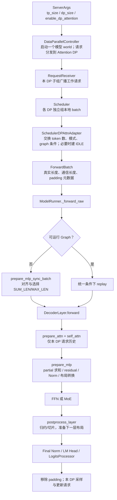

# SGLang DP Attention 源码走读：从请求分发到下一层与 logits

**简体中文** | [English](../../../en/sglang-source-reading/05-layer-communication/03-dp-attention-code-walkthrough.md)

本章以本仓库源码快照 `587eb0b3a56cd2f014daf3b0fc8ba333da88df36` 为依据，走读默认非 CP 的 `DeepseekV2DecoderLayer` 路径，并分别展开全局 gather 与专家 dispatch 两种模式。代码块若标为“节选”或“教学伪代码”，只保留讨论所需分支；真实执行以链接中的完整函数为准。

先读 [DP Attention 原理](../../ai-infra-basic/Parallel_Strategy/01-dp-attention-principles.md)。已有的 [LayerCommunicator 导读](./01-layer-communicator-and-common-layers.md)与 [TP/DP/EP 切分及 Ascend](./02-tp-dp-ep-sharding-and-ascend-npu.md)覆盖通用算子与权重切片，本章集中解释 DP Attention 贯穿各模块的执行契约。

## 1. 一次 forward 的总路线



这条链路有两类通信：Scheduler 同步的是小型**执行元数据**；layer 通信移动或归约的是 `[tokens,H]` 激活/专家数据。前者保证各 rank 进入兼容的执行轮次，后者让不同模块获得正确张量。

## 2. 源码地图与阅读顺序

以下链接指向仓库内文件；固定版本可在 GitHub 把 `main` 替换为上述 commit 查看。函数名比可变行号更适合作为阅读锚点。

| 层次 | 源码 | 优先看什么 |
|---|---|---|
| 参数 | [server_args.py](../../../../python/sglang/srt/server_args.py) | `_handle_data_parallelism()`、`_handle_context_parallelism()` |
| 启动/路由 | [data_parallel_controller.py](../../../../python/sglang/srt/managers/data_parallel_controller.py) | `launch_dp_attention_schedulers()`、`launch_tensor_parallel_group()`、`round_robin_scheduler()` 等 dispatcher |
| 请求广播 | [request_receiver.py](../../../../python/sglang/srt/managers/scheduler_components/request_receiver.py) | `_broadcast_reqs_across_ranks()` |
| 分布式组 | [parallel_state.py](../../../../python/sglang/srt/distributed/parallel_state.py) | `initialize_model_parallel()`、`_ATTN_TP`、`_ATTN_CP`、`_MOE_EP` |
| DP 公共函数 | [dp_attention.py](../../../../python/sglang/srt/layers/dp_attention.py) | `compute_dp_attention_world_info()`、`DpPaddingMode`、`dp_gather_*()`、`dp_scatter()` |
| 调度轮次 | [scheduler.py](../../../../python/sglang/srt/managers/scheduler.py) / [dp_attn.py](../../../../python/sglang/srt/managers/scheduler_components/dp_attn.py) | `maybe_prepare_mlp_sync_batch()`、`MLPSyncBatchInfo.all_gather()`、`get_idle_batch()` |
| 运行时 batch | [forward_batch_info.py](../../../../python/sglang/srt/model_executor/forward_batch_info.py) | `prepare_mlp_sync_batch()`、`post_forward_mlp_sync_batch()` |
| 模型入口 | [model_runner.py](../../../../python/sglang/srt/model_executor/model_runner.py) | `init_torch_distributed()`、`_forward_raw()` |
| 模型层 | [deepseek_v2.py](../../../../python/sglang/srt/models/deepseek_v2.py) | `DeepseekV2AttentionMLA.__init__()`、`DeepseekV2DecoderLayer.forward()`、`DeepseekV2MoE.forward()` |
| 布局转换 | [communicator.py](../../../../python/sglang/srt/layers/communicator.py) | `LayerScatterModes`、`LayerCommunicator`、三个 `Communicate*Fn` |
| Graph | [cuda_graph_runner.py](../../../../python/sglang/srt/model_executor/cuda_graph_runner.py) | `can_run()`、`capture_one_batch_size()`、`replay_prepare()` |
| 输出头 | [logits_processor.py](../../../../python/sglang/srt/layers/logits_processor.py) | `compute_dp_attention_metadata()`、`_gather_dp_attn_hidden_states()`、`_scatter_dp_attn_logits()` |
| 同步开关 | [utils/common.py](../../../../python/sglang/srt/utils/common.py) | `require_mlp_tp_gather()`、`require_attn_tp_gather()`、`require_mlp_sync()` |

## 3. 从参数走到一个 rank 网格

贯穿本章的主配置为：

```text
tp_size=4, dp_size=2, enable_dp_attention=True
pp_size=1, attn_cp_size=1
无专用 MoE A2A backend，moe_dense_tp_size=None
关闭本章不展开的 CP、TBO 与通信融合
```

这表示 **4 个计算 rank**，分成两个 Attention DP 子组，各自 Attention TP 为 2。普通 DP 关闭该开关时，同样的 `tp_size=4,dp_size=2` 则需要两个完整 TP 副本、共 8 个计算 rank。

`ServerArgs._handle_data_parallelism()` 节选：

```python
if self.dp_size == 1:
    self.enable_dp_attention = False
    self.enable_dp_lm_head = False

if self.enable_dp_attention:
    self.schedule_conservativeness = self.schedule_conservativeness * 0.3
    assert self.tp_size % self.dp_size == 0
    self.chunked_prefill_size = self.chunked_prefill_size // self.dp_size
```

因此启动输入值不一定是最终生效值。例如本快照会调整 chunked prefill budget。结合 CP 时还要通过 `tp_size % (dp_size*attn_cp_size)==0` 等校验；不能只用第一条整除检查判断组合合法。

`compute_dp_attention_world_info()` 的核心为：

```python
attn_dp_size = dp_size if enable_dp_attention else 1
attn_tp_size = tp_size // attn_dp_size // attn_cp_size
attn_tp_rank = tp_rank % attn_tp_size
# enable_dp_attention=True 分支
attn_dp_rank = tp_rank // (attn_tp_size * attn_cp_size)
```

本例：

```text
global TP/model ranks: 0  1  2  3
attention DP ranks:   0  0  1  1
attention TP ranks:   0  1  0  1
ATTN_TP groups: [0,1] 和 [2,3]
全局 TP group: [0,1,2,3]
```

## 4. 启动与请求分发：每个 DP 有入口，计算 world 只有一个

`DataParallelController.launch_dp_attention_schedulers()` 为每个 DP 分配工作入口，然后调用一次 `launch_tensor_parallel_group()`。后者遍历模型 world 的 TP/PP ranks，通过公式算出每 rank 的 Attention DP 身份。

节选：

```python
_, _, dp_rank, _ = compute_dp_attention_world_info(
    server_args.enable_dp_attention,
    tp_rank,
    server_args.tp_size,
    server_args.dp_size,
    server_args.attn_cp_size,
)
rank_port_args = PortArgs.init_new(server_args, dp_rank, worker_ports)
# DP Attention 复用同一个模型 world 的分布式初始化端口
rank_port_args.nccl_port = port_args.nccl_port
```

变量名 `nccl_port` 不表示硬件必须是 CUDA；设备 backend 后续才选择。

Controller 用 round-robin、负载策略或请求中的 `routed_dp_rank` 选择 Attention DP 入口。一个请求一旦进入本地调度和 KV 状态，后续 decode 通常在所属组继续；每 token 轮换到另一个组会需要额外状态迁移，不能仅改 dispatcher。

`RequestReceiver._broadcast_reqs_across_ranks()` 区分工作请求与控制请求：

```text
工作请求：组 leader 收到 -> ATTN_TP 广播 -> 必要时 ATTN_CP 广播
控制请求：默认全局 TP 广播
          enable_dp_attention_local_control_broadcast 时用局部子组广播
```

本例请求 A/B 在 rank0/1 的 Scheduler 中一致，请求 C/D 在 rank2/3 中一致。各 DP 组的 waiting/running batch 可以不同；组内 rank 必须按同一请求顺序进行 Attention TP。

## 5. ModelRunner 初始化分布式与 DP buffer 元数据

`ModelRunner.init_torch_distributed()` 节选：

```python
init_distributed_environment(
    backend=backend,
    world_size=self.tp_size * self.pp_size,
    rank=self.tp_size * self.pp_rank + self.tp_rank,
    # ...
)
initialize_model_parallel(
    tensor_model_parallel_size=self.tp_size,
    attention_data_parallel_size=self.dp_size,
    attention_context_model_parallel_size=self.attn_cp_size,
    expert_model_parallel_size=self.moe_ep_size,
    moe_data_model_parallel_size=self.moe_dp_size,
    # ...
)
initialize_dp_attention(server_args=self.server_args, model_config=self.model_config)
```

`parallel_state.py` 先构造全局 TP，再构造 Attention TP/CP 与 MoE DP/EP/TP groups。`initialize_dp_attention()` 保存 Attention DP rank/size，并用模型 `hidden_size`、dtype、device 初始化 `_DpGatheredBufferWrapper` 的分配元数据。

因此要区分：

- **group 初始化**：确定谁参加某次 collective；
- **buffer 长度更新**：每轮根据 token 数决定分配或使用多少行；
- **数值归约**：forward 时对 buffer 执行 collective。

`moe_dense_tp_size` 还会影响 local DP 计算；不能把 `get_local_attention_dp_rank()` 无条件替换为全局 Attention DP rank。`get_dp_local_info()` 对全局 DP gather/scatter 明确使用全局 rank。

## 6. Scheduler：独立组 batch，再协调执行轮次

Scheduler 先选择本地 prefill/decode batch，再调用 `dp_attn_adapter.maybe_prepare_mlp_sync_batch()`。`require_mlp_sync()` 的判断为：

```python
return server_args.enable_dp_attention or require_gathered_buffer(server_args)
```

即使专用 MoE backend 使全局 hidden gather 不再需要，DP Attention 的执行元数据同步也仍可能需要。不要把 `require_mlp_tp_gather=False` 当成“所有跨 DP 同步关闭”。

### 6.1 不同 forward mode 如何数 token

`prepare_mlp_sync_batch_raw()`：

| 本地 mode | `num_tokens` | 含义 |
|---|---:|---|
| 无 batch / PREBUILT / IDLE | 0 | 没有本轮真实模型 token |
| DECODE | `batch_size()` | 普通自回归每请求一个 token |
| EXTEND 等 | `extend_num_tokens` | 本轮新 prefill token 总数 |

同时记录 `num_tokens_for_logprob`。Prefill 并不总对每个 hidden row 都执行输出头；prompt logprob 的返回范围也会改变需要输出的行数。后续 LM Head 使用的是输出/logprob 元数据，不一定是 MLP 的全 token 长度。

### 6.2 六项元数据和一次 all-gather

`MLPSyncBatchInfo._get_local_tensor()` 返回：

```python
[
    self.num_tokens,
    self.num_tokens_for_logprob,
    int(self.can_cuda_graph),
    int(self.is_extend_in_batch),
    int(self.local_can_run_tbo),
    self.local_forward_mode,
]
```

`all_gather()` 的逻辑 shape：

```text
local_info: [6]
global_info: [DP, ATTN_TP*ATTN_CP, 6]
tp0_info = global_info[:,0,:]: [DP,6]
```

组内多个 rank 代表同一 DP workload，所以取每组的第 0 份。还会给 inactive ranks 设置 fallback。聚合规则包括：

```text
global_num_tokens = 每 DP 的 token count
can_cuda_graph = 各 DP graph 条件取 min，即所有参与者同意
is_extend_in_batch = 各 DP extend 条件取 max，即任一组有 extend
```

源码可选 CPU group 或 device group，并尽量减少 D2H 次数。这里交换的是少量整数；它与后文 hidden-state gather 是两次不同的通信。

### 6.3 无本地请求为何创建 IDLE batch

节选：

```python
need_idle_batch = max(mlp_sync_info.global_num_tokens) > 0
if need_idle_batch:
    if local_batch is None:
        batch_to_gather = local_batch = get_idle_batch()
```

这是默认未开启 `SGLANG_SCHEDULER_SKIP_ALL_GATHER` 分支；源码还包含 PREBUILT inner idle 等处理。`get_idle_batch()` 构造空请求列表并执行 `prepare_for_idle()`。

关键不变量是：参与共享 collective 的 rank，必须进入相容的通信顺序。IDLE 组没有本地采样工作，但不能随意跳过整轮模型通信。专家 backend 下，空 source rank 也可能需要执行其拥有的远端专家。

## 7. ForwardBatch：把计数转换成可通信的长度

`ScheduleBatch` 的元数据进入 `ForwardBatch`：

```text
original_global_num_tokens_cpu   原始计数引用，使用时注意可变列表语义
global_num_tokens_cpu/gpu        当前 forward 使用的通信布局长度
global_num_tokens_for_logprob_*  输出/logprob 所需行数
dp_padding_mode                 SUM_LEN / MAX_LEN
dp_local_start_pos/num_tokens    本 DP 在全局 buffer 中的区间
global_dp_buffer_len             全局 hidden buffer 行数
```

一些列表会被对齐过程原地更新。观察“原始”字段时应结合赋值和修改位置，诊断时可以另存真实计数，而不是只靠变量名判断。

`ModelRunner._forward_raw()` 先判断 Graph 能否 replay。若不能，才走 eager 的：

```python
if forward_batch.global_num_tokens_cpu is not None:
    forward_batch.prepare_mlp_sync_batch(self)
else:
    forward_batch.prepare_attn_tp_scatter_input(self)
```

### 7.1 对齐、padding、buffer 的顺序

`ForwardBatch.prepare_mlp_sync_batch()` 节选：

```python
for i in range(sync_group_size):
    global_num_tokens[i] = ceil_align(global_num_tokens[i], attn_tp_size)
for i in range(sync_group_size):
    global_num_tokens[i] = ceil_align(global_num_tokens[i], attn_cp_size * 2)

dp_padding_mode = DpPaddingMode.get_dp_padding_mode(
    self.is_extend_in_batch, global_num_tokens
)
if dp_padding_mode.is_max_len():
    max_num_tokens = max(global_num_tokens)
    global_num_tokens = [max_num_tokens] * sync_group_size
    buffer_len = max_num_tokens * sync_group_size
else:
    buffer_len = sum(global_num_tokens)
```

本例真实 decode counts `[4,2]` 已满足 `T=2,C=1` 的两次对齐。eager 选择 MAX_LEN 后，通信长度为 `[4,4]`，全局 buffer 为 `[8,H]`。真实 DP1 仍只有两条请求，后两行用于 padding。

`_pad_inputs_to_size()` 会处理 `input_ids`、`positions`、`req_pool_indices`、`seq_lens`、`out_cache_loc` 等，填充值由 backend 契约决定。不能只补 hidden tensor，而让 KV 写入位置或请求索引仍为旧长度。

`get_dp_local_info()` 使用通信长度的前缀和：

```text
start_d = sum(global_num_tokens_gpu[:d])
length_d = global_num_tokens_gpu[d]
```

所以 MAX_LEN `[4,4]` 的 DP1 起始行是 4，SUM_LEN `[4,2]` 的 DP1 起始行也是 4，但总长度分别是 8 和 6。真实 `[3,1]` 先对齐为 `[4,2]`，再选择模式；不能用未对齐的 `3` 算 DP1 偏移。

## 8. 模型投影：Attention 权重使用 Attention TP rank

`DeepseekV2AttentionMLA.__init__()` 明确使用：

```python
attn_tp_rank = get_attention_tp_rank()
attn_tp_size = get_attention_tp_size()
self.num_local_heads = num_heads // attn_tp_size
# q_b_proj、kv_b_proj、o_proj 构造时传入上述 rank/size
```

这使 rank0 与 rank2 持有相同编号的 Attention head shard，却处理不同 DP 的请求；rank1 与 rank3 也是如此。低秩 down projection 则包含 `ReplicatedLinear`。

取教学 MLA 配置 `H=4096,N=32,Dcq=1536,Dc=512,Dh=128,Dr=64,Dv=128`、每 DP padded token 数 `m=4`：

| 步骤 | 每 rank 逻辑 shape | 所有权 |
|---|---:|---|
| Layer 输入 | `[4,4096]` | 同 DP 的两个 rank 相同 |
| Query latent | `[4,1536]` | replicated down projection |
| Query 上投影 | `[4,16*(128+64)] = [4,3072]` | 本 rank 16 个 heads |
| Query reshape | `[4,16,192]` | 再拆 content 与 RoPE |
| 内容 latent / position key | `[4,512]`、`[4,64]` | 写本 DP 的 MLA cache |
| Head 输出 | `[4,16,128]` | 使用本请求可见历史 |
| Output projection | `[4,4096]` | `reduce_results=False`，数值为 partial |

MLA 的吸收式/展开式与 backend 可能隐藏中间量，数学详见 [MLA 教程](../../ai-infra-basic/Model_Architecture/04-multi-head-latent-attention.md)。DP Attention 不改变其注意力公式，而是改变请求与 head 工作的放置。

## 9. DecoderLayer：三个固定的通信边界

`DeepseekV2DecoderLayer.forward()` 的节选结构：

```python
hidden_states, residual = self.layer_communicator.prepare_attn(
    hidden_states, residual, forward_batch, ...
)
hidden_states = self.self_attn(...)
hidden_states, residual = self.layer_communicator.prepare_mlp(
    hidden_states, residual, forward_batch
)
use_reduce_scatter = self.layer_communicator.should_use_reduce_scatter(forward_batch)
hidden_states = self.mlp(
    hidden_states, forward_batch, should_allreduce_fusion, use_reduce_scatter, ...
)
if not should_allreduce_fusion:
    hidden_states, residual = self.layer_communicator.postprocess_layer(
        hidden_states, residual, forward_batch
    )
```

`LayerScatterModes` 在初始化时选择布局；`LayerCommunicator._post_init_communicate()` 为上述三个边界预选函数。关键模式：

| 条件 | `mlp_mode` | 主要执行路径 |
|---|---|---|
| Sparse layer，无专用 A2A | `FULL` | gather 到全局 rows，执行 FFN/专家工作，再返回 DP rows |
| Sparse layer，专用 A2A 或指定特殊 all-gather MoE 路径 | `SCATTERED` | dispatcher 在 communicator 外负责 token 交换 |
| Dense layer，`moe_dense_tp_size=1` | `SCATTERED` | 每 rank 用本地完整 dense MLP 处理自己的 rows |
| Dense layer，普通配置 | `FULL` | 全局 TP MLP |
| 特定 CP/MoE-DP 组合 | `MOE_FULL` | 额外 CP/MoE 布局，见通用通信篇 |

这说明“打开 DP Attention 后所有层都 all-gather”并不成立。要先确定 layer 类型、A2A backend、dense 配置和 CP，再解释具体 collective。

## 10. FULL 路径：partial 求和与 DP gather 如何合并

`CommunicateWithAllReduceAndLayerNormFn._gather_hidden_states_and_residual()` 的关键逻辑，节选并省略其他分支：

```python
use_layer_norm_before_gather = context.attn_tp_size == 1
if use_layer_norm_before_gather and hidden_states.shape[0] != 0:
    hidden_states, residual = layernorm(hidden_states, residual)
elif context.attn_tp_rank == 0:
    hidden_states += residual

hidden_states, local_hidden_states = get_global_dp_buffer(get_tp_group()), hidden_states
dp_gather_partial(hidden_states, local_hidden_states, forward_batch)
if not use_layer_norm_before_gather:
    dp_scatter(residual, hidden_states, forward_batch)
    if hidden_states.shape[0] != 0:
        hidden_states = layernorm(hidden_states)
```

当 Attention TP 为 2 时，两个 rank 的 `A_partial` 必须相加。残差 `X` 只由组内 rank0 加一次，gather 后得到全局 `R=concat_d(X_d+sum_a A_da)`。再复制本 DP 的 `R` 到本地 residual，RMSNorm 后全局 hidden 送入 MLP。

**Residual 仍为本 DP 的 `[m,H]`，MLP hidden 是全局 `[D*m,H]`。** 它们不要求此刻 shape 相同，因为 MLP 后会把 hidden 返回到本地布局。

### 10.1 SUM_LEN 的 all-reduce

`_dp_gather_via_all_reduce()` 节选：

```python
local_start_pos, local_num_tokens = get_dp_local_info(forward_batch)
global_tokens.fill_(0)
if local_tokens.shape[0] > 0 and (is_partial or get_attention_tp_rank() == 0):
    memcpy_triton(global_tokens, local_tokens, 0,
                  local_start_pos, local_num_tokens, False)
# 浮点 hidden 的通常路径
global_tokens[:] = tensor_model_parallel_all_reduce(global_tokens)
```

SUM_LEN 没有调用变长 all-gather。它利用每 DP 的不重叠区间加零，再 all-reduce；partial 输入在区间内求和，replicated 输入通过组内 leader 去重。整数 input IDs 另有源码中的 `inplace_all_reduce` 特例。

### 10.2 MAX_LEN 的 reduce-scatter + all-gather

`_dp_gather_via_all_gather()` 节选：

```python
if get_attention_tp_size() == 1:
    get_tp_group().all_gather_into_tensor(global_tokens, local_tokens)
    return
if not is_partial:
    if get_attention_tp_rank() != 0:
        local_tokens.fill_(0)
scattered_local_tokens = local_tokens.tensor_split(get_attention_tp_size())[
    get_attention_tp_rank()
]
get_attention_tp_group().reduce_scatter_tensor(scattered_local_tokens, local_tokens)
get_tp_group().all_gather_into_tensor(global_tokens, scattered_local_tokens)
```

本例 `[4,H]` partial 经组内 reduce-scatter 后，每 rank 得到 `[2,H]` 完整数值的 token slice；全局 4-rank all-gather 得 `[8,H]`。rank 顺序恰好排列为 DP0 两个片段，接着 DP1 两个片段。

`local_tokens.fill_(0)` 与 reduce-scatter 的输出切片可能修改输入存储；这些函数有明确 buffer 生命周期和非 alias 假设。教学复制代码时不能额外假设所有输入都会被保留。

## 11. MLP 后：scatter 是本地 copy，reduce-scatter 是 collective

无专用 A2A 的全局 TP FFN/MoE 产生 `[N,H]` 输出。若它尚为 partial，各 rank 的结果需要归约。模型层把 `use_reduce_scatter` 传给 MLP，决定是否跳过原本的输出 all-reduce。

`CommunicateSummableTensorPairFn._scatter_hidden_states()`：

```python
if should_use_dp_reduce_scatterv():
    get_tp_group().reduce_scatterv(global_hidden_states,
        output=hidden_states, sizes=get_dp_global_num_tokens())
elif allow_reduce_scatter and forward_batch.dp_padding_mode.is_max_len():
    dp_reduce_scatter_tensor(hidden_states, global_hidden_states)
else:
    dp_scatter(hidden_states, global_hidden_states, forward_batch)
```

两条基本情况：

- **MLP 已完成 all-reduce**：全局结果在各 rank 相同，`dp_scatter()` 只需本地复制本 DP 区间，无网络 scatter。
- **MLP 跳过 all-reduce，输出仍 partial**：`dp_reduce_scatter_tensor()` 同时求和和返回局部 rows，避免先复制完整 global result。

当 `P==D` 时 Attention TP 为 1，直接 world reduce-scatter；当 `P>D` 时先 world reduce-scatter 到每 rank 一个更小 row block，再 Attention TP all-gather，使组内各 rank 恢复同一个 DP 的完整 token rows。

```text
本例 MLP partial: 每 rank [8,H]
world reduce-scatter: 每 rank [2,H] 完整数值
ATTN_TP all-gather: rank0/1 同为 DP0 [4,H]
                   rank2/3 同为 DP1 [4,H]
```

如果 MLP 内已经 all-reduce，却再次 reduce-scatter 求和，会多加 `P` 份结果。反之，若输出仍 partial 却只本地 copy，会漏掉其他 rank 的贡献。**通信和 `skip_all_reduce/use_reduce_scatter` 标志必须配对阅读。**

## 12. 专家通信分支：SCATTERED token 的生命周期

对专用 A2A backend，`prepare_mlp()` 使用 `_scatter_hidden_states_and_residual()`：

```python
input_hidden_states = hidden_states
hidden_states = hidden_states.tensor_split(context.attn_tp_size)[context.attn_tp_rank]
attn_tp_reduce_scatter_tensor(hidden_states, input_hidden_states)
if residual_input_mode == ScatterMode.TP_ATTN_FULL:
    residual = residual.tensor_split(context.attn_tp_size)[context.attn_tp_rank]
if hidden_states.shape[0] != 0:
    hidden_states, residual = layernorm(hidden_states, residual)
```

此时每 rank 为 `[m/T,H]`，数值完整。Residual 同步切片，Norm 在本地 rows 上完成。

`DeepseekV2MoE.forward()` 根据 `_enable_a2a_moe` 分支进入 `forward_normal()` 或名字为 `forward_deepep()` 的通用专用通信路径。后一函数名并不意味着当前 backend 必然是 DeepEP；本快照还会按配置接入其他 A2A backend。

```text
SCATTERED hidden [n_source,H]
  -> router logits [n_source,E]
  -> top-k expert ids/weights [n_source,K]
  -> self.experts / dispatcher
  -> destination expert input [n_e,H]
  -> expert output [n_e,H]
  -> combine / weighted aggregation
  -> source-rank result [n_source,H]
```

组内请求 rows 的位置和 expert owner rank 是两个映射。Combine 负责把每个 token 的多个专家结果加权回来源行；attention 子组的 KV 映射无需因此重排到 expert owner。

后续 layer 若继续接受 `SCATTERED`，输出可保持局部。进入需要 `TP_ATTN_FULL` 的 Attention 时，`CommunicateSimpleFn._scattered_to_tp_attn_full()` 在 Attention TP group 内 all-gather。最后一层也按模型输出布局恢复。

空输入时 `forward_deepep()` 会构造 empty top-k output，仍进入专家路径所需的调用。不能只因 `n_source=0` 就在外部提前返回并跳过通信。

## 13. LM Head：DP Attention 与 DP LM Head 是独立开关

最终 hidden 已回到本 Attention DP 的 token 布局，但输出头可能仍使用全局词表 TP。

`LogitsProcessor.__init__()`：

```python
self.use_attn_tp_group = get_global_server_args().enable_dp_lm_head
if self.use_attn_tp_group:
    self.attn_tp_size = get_attention_tp_size()
    self.do_tensor_parallel_all_gather_dp_attn = False
else:
    self.do_tensor_parallel_all_gather = (
        not skip_all_gather and get_tensor_model_parallel_world_size() > 1
    )
    self.do_tensor_parallel_all_gather_dp_attn = (
        self.do_tensor_parallel_all_gather and get_attention_dp_size() != 1
    )
```

默认全局词表 TP 路径需让各词表 shard 对同一组输出 rows 计算：

```text
本地输出 rows [R_d,H]
  -> dp_gather_replicate，聚合需输出/logprob 的 rows
  -> 全局词表 shard GEMM [sum(R_d),V/P]
  -> gather vocabulary logits
  -> dp_scatter 回本 DP 的 [R_d,V]
```

这是 **replicated gather**，因为最终 hidden 在组内已完整，不能再当 Attention partial 加和。`LogitsMetadata.compute_dp_attention_metadata()` 根据 `global_num_tokens_for_logprob` 单独计算偏移，并分配更小 gathered buffer；它采用自己的 SUM_LEN metadata。

开启 `enable_dp_lm_head` 后，相关模型需让 LM Head 权重分片和 logits gather 一起使用 Attention TP group。只改 `LogitsProcessor` 而不检查模型的 `ParallelLMHead` 构造是不完整的适配。参数校验要求同时开启 DP Attention。

## 14. Graph：所有参与者需要兼容的捕获形状和 collective

Graph 路径与 eager padding 程序不同。`CudaGraphRunner.can_run()` 在需要 MLP TP gather 时，依据跨 DP 的最大 token 数推导 graph batch；推测解码还需考虑每请求 token 数。

```python
# 普通 decode 的节选
cuda_graph_bs = max(forward_batch.global_num_tokens_cpu)
if self.require_mlp_sync:
    is_bs_supported = is_bs_supported and forward_batch.can_run_dp_cuda_graph
```

`replay_prepare()` 用 capture bucket 大小覆盖实际长度，把当前输入、sequence lengths、cache slots 等复制到静态 buffer。`capture_one_batch_size()` 在 gather 路径为各 DP 设置相同 bucket token 数，全局 buffer 为 `D*bucket_tokens`。

```text
真实 counts [3,1]
假设选中 bucket=4
Graph 固定通信布局 [4,4]，全局 hidden [8,H]
最后返回：DP0 3个真实结果，DP1 1个真实结果
```

图路径通常默认 MAX_LEN（源码有 ROCm 特例）。各 rank 必须使用相容的 collective buffer 和执行顺序；某 DP 有 extend 会影响全局 graph 条件。完全局部 dense/专用 A2A 路径的选桶条件须按 `require_mlp_tp_gather` 等分支单独阅读，不能把上述公式套到所有 backend。

Eager 执行结束由 `post_forward_mlp_sync_batch()` 恢复原 batch/mode，并裁剪真实结果；Graph replay 有自己的结果裁剪。Padding 行不得成为真实采样结果，也不能污染真实 request 的 KV 或 recurrent state。

## 15. Ascend NPU：共用拓扑，检查实际执行路径

本快照的相关文件：

- [parallel_state.py](../../../../python/sglang/srt/distributed/parallel_state.py)：设备 `npu` 通常选择 `hccl`，还有配置控制的其他 backend 分支。
- [ascend_backend.py](../../../../python/sglang/srt/hardware_backend/npu/attention/ascend_backend.py)：Attention backend 读取 Attention TP 尺寸等元数据。
- [npu_graph_runner.py](../../../../python/sglang/srt/hardware_backend/npu/graph_runner/npu_graph_runner.py)：`NPUGraphRunner(CudaGraphRunner)`，替换 graph 创建/捕获等设备操作，复用多项 batch/padding/graph 判定逻辑。
- [fuseep.py](../../../../python/sglang/srt/hardware_backend/npu/moe/fuseep.py)：Ascend FuseEP dispatch、专家计算与 combine 路径。

Rank 公式和 token 所有权不因 NCCL/HCCL 改变，但实际 collective、copy kernel、dtype、graph capture 和专家路由支持会受版本影响。`dp_attention.py` 的 copy helper 含 Triton kernel；只有确认目标部署提供对应可执行路径，才可断言某组合在该 NPU 环境可运行。

本章已静态核对源码，并用 CPU demo 验证布局和数学不变量；未执行多卡 GPU/NPU serving 或 HCCL 性能测试。硬件侧详细的 TP/EP、权重布局与 FuseEP 说明直接读 [Ascend 切分篇](./02-tp-dp-ep-sharding-and-ascend-npu.md)。

## 16. 把一个 `[4,2]` decode round 从头跟到尾

下面是主配置、MAX_LEN、无 A2A、无额外融合时的全张量账本，`H=4096,T=2`。真实 DP0 有 4 个请求，DP1 有 2 个请求，普通 decode 每请求一个 token。

| 阶段 | rank0/1 | rank2/3 | 数据含义 |
|---|---|---|---|
| 本地 Scheduler | 4 个请求 | 2 个请求 | 组内一致，组间独立 |
| Sync metadata | 同步得到 `[4,2]` | 同步得到 `[4,2]` | 同一个执行轮次 |
| Eager padding | `input_ids [4]` | `input_ids [4]` | DP1 后 2 行为 padding |
| Embedding/层输入 | `[4,4096]` | `[4,4096]` | 本 DP 完整 rows，组内 replicated |
| Attention output | `[4,4096]` partial | `[4,4096]` partial | 每 rank 不同 head 贡献 |
| ATTN_TP reduce-scatter | 每 rank `[2,4096]` | 每 rank `[2,4096]` | 组内求和后各取一半 rows |
| Global all-gather | 每 rank `[8,4096]` | 每 rank `[8,4096]` | DP0 4行 + DP1 4行 |
| Post-Attention Norm | hidden `[8,4096]` | hidden `[8,4096]` | MLP 输入完整数值 |
| 本地 residual | `[4,4096]` | `[4,4096]` | 只保留本 DP 的 residual stream |
| TP FFN/MoE | `[8,4096]` partial 或已归约 | 同左 | 取决于 `use_reduce_scatter` |
| 返回 DP 布局 | `[4,4096]` | `[4,4096]` | collective 归约或本地 copy |
| 下一层 | 重复以上边界 | 重复以上边界 | KV 历史仍只属于本 DP 请求 |
| 输出/logits | 本 DP 真实 rows | 本 DP 真实 rows | 可额外经过 LM Head 的 DP gather |
| 去 padding 后采样 | 4 个结果 | 2 个结果 | 不生成 padding token |

Attention 算子内部的 score shape 还取决于各请求可见长度。即使 packed hidden 为 `[4,H]`，也不能用它推断 4 个请求都拥有相同长度的 KV。

## 17. 常见故障与应检查的不变量

| 症状 | 优先追踪 |
|---|---|
| `dp_size=1` 正确，DP>1 输出成倍放大 | replicated 输入是否用了 partial gather；residual 是否加了多次 |
| 仅当 Attention TP>1 错误 | output projection partial 是否归约；head shard 是否使用 attn TP rank |
| 某 DP 没请求时挂起 | IDLE batch、空 MoE source、跨 rank collective 顺序 |
| 均衡 batch 正确，不均衡错误 | 原始/对齐/bucket 长度；SUM/MAX；前缀和偏移 |
| MoE 输出少一部分或被乘以 world size | `skip_all_reduce`、`use_reduce_scatter` 与 postprocess 是否配对 |
| eager 正确，Graph 错误 | 全局 graph 同意、选桶、静态 buffer 刷新、padding mask |
| 只在 prompt logprob 错误 | MLP token 数与 logprob rows 混用；LogitsMetadata offset |
| 开 DP LM Head 后错误 | LM Head 权重 shard 的 group 与 logits gather group 不一致 |
| 切 DP 组后 prefix 命中率变低 | 请求路由与组内 prefix-cache 所有权 |
| NPU 仅特定组合失败 | HCCL group、copy helper、Attention/MoE backend 与 graph 支持 |

性能分析时，分别看元数据同步等待、Attention、Norm/布局转换、MoE dispatch/combine、FFN、LM Head 与 Graph padding。单独看到某次 all-gather 较快，不足以证明端到端 DP Attention 更快。

## 18. 运行教学模拟并带着问题阅读代码

```bash
python3 learning/zh/ai-infra-basic/Parallel_Strategy/dp_attention_layout_demo.py
```

它不依赖 torch，模拟 SUM_LEN 零 buffer all-reduce、MAX_LEN 子组 reduce-scatter + 全局 all-gather、replica 去重、residual 单次相加、以及 FFN 输出返回的等价性。

阅读任务：

1. 沿 `get_next_batch_to_run()` 解释本地 batch 为 None 时，哪一段代码让它变成 IDLE。
2. 沿 `prepare_mlp_sync_batch()` 解释真实 `[3,1]` 为何不能直接作为 MAX_LEN collective 尺寸。
3. 在 `dp_gather_partial()` 与 `dp_gather_replicate()` 各找一个调用者，说明各自数据已不已归约。
4. 对 `T=2` 解释为何 Attention Norm 不应直接分别作用于两个 partial 输出。
5. 找到 `DeepseekV2MoE.forward_normal()` 中跳过 all-reduce 的条件，再找到与之配对的 communicator 分支。
6. 对 A2A 路径画出 source-token 到 expert-owner 再返回 source-token 的映射。
7. 用 `LogitsProcessor` 证明 DP Attention 不会自动开启 DP LM Head。

## 19. 固定源码与延伸阅读

- [固定快照：dp_attention.py](https://github.com/cl-vv-h/SGLang_Tutor/blob/587eb0b3a56cd2f014daf3b0fc8ba333da88df36/python/sglang/srt/layers/dp_attention.py)
- [固定快照：communicator.py](https://github.com/cl-vv-h/SGLang_Tutor/blob/587eb0b3a56cd2f014daf3b0fc8ba333da88df36/python/sglang/srt/layers/communicator.py)
- [固定快照：scheduler_components/dp_attn.py](https://github.com/cl-vv-h/SGLang_Tutor/blob/587eb0b3a56cd2f014daf3b0fc8ba333da88df36/python/sglang/srt/managers/scheduler_components/dp_attn.py)
- [原理与数学](../../ai-infra-basic/Parallel_Strategy/01-dp-attention-principles.md)
- [Scheduler 核心](../02-scheduler-runtime/02-scheduler-core.md)
- [KV 与 prefix cache](../03-cache-memory/03-kv-cache-radix-cache.md)
- [执行图基础](../../ai-infra-basic/Execution_Graph/README.md)
