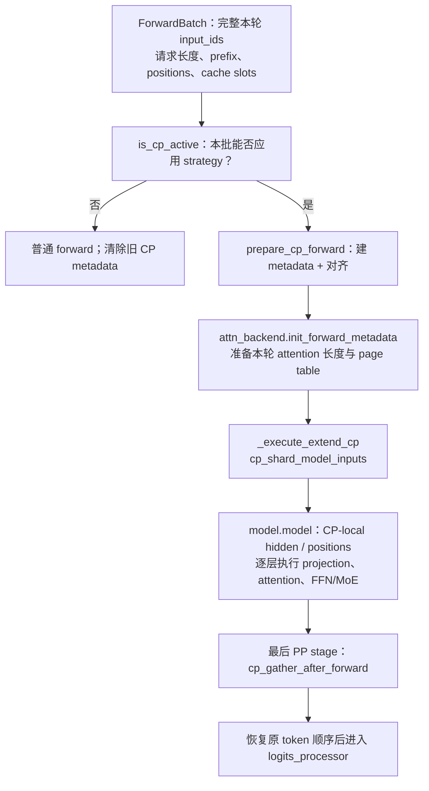
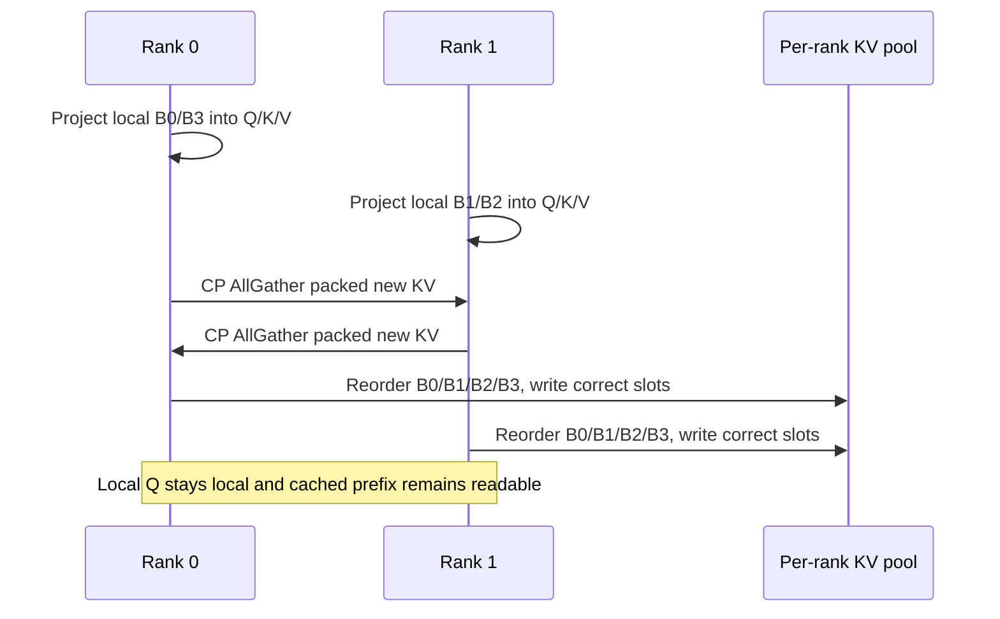
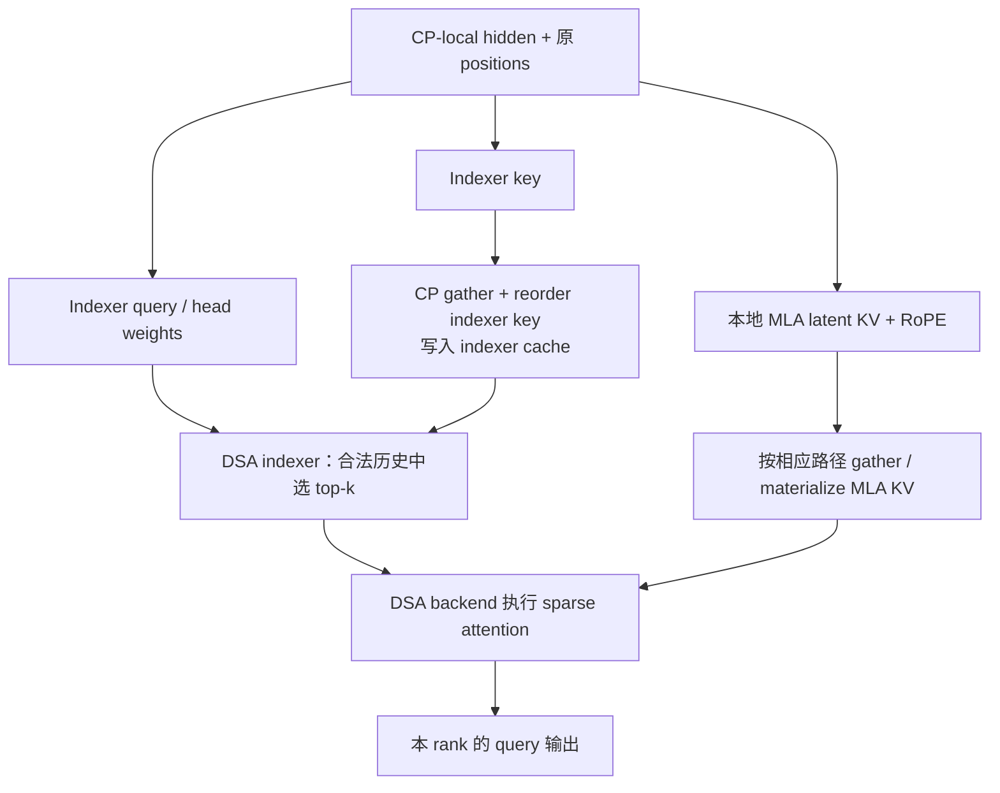

# SGLang PCP 源码走读：从参数到 query 分片、KV 交换与输出恢复

**简体中文** | [English](../../../en/sglang-source-reading/05-layer-communication/04-prefill-context-parallel-code-walkthrough.md)

先读 [PCP 原理篇](../../ai-infra-basic/Parallel_Strategy/03-prefill-context-parallelism.md)，特别是第二节的 prefix/query 行号。本篇继续回答：**是谁切了数据、切哪些张量、何时通信、谁调用 attention kernel、最后怎样恢复原顺序？**

之前 [GLM-5.2 §10.4](../../sglang-ascend-npu/source-code-walkthrough/examples/02-glm-5.2-end-to-end.md) 只有旧 NPU 分支的概要，[NPU 通信篇](../../sglang-ascend-npu/source-code-walkthrough/15-distributed-hccl-and-communication.md) 解释了一部分 layer boundary；两者都不是完整 PCP 调用链。本篇把它们接起来，并单独讲清新版上游。

## 1. 先选源码基线：这里有三条真实路径

**核对日期：2026-10-16。** 新版统一 strategy 路径固定到 [SGLang f2b73d4](https://github.com/sgl-project/sglang/tree/f2b73d4f9b4e64415b8d775b0f811c7801f1728b)；旧 NPU 路径按本教程仓库 `e4df326` 的本地运行时走读。没有把上游代码替换进本仓库。

| 路径 | 入口组织 | attention 的实际执行者 |
|---|---|---|
| 上游 zigzag + dense FlashAttention | runner + `ZigzagCPStrategy` | FA backend callback，由 strategy 分别调用前/后块 |
| 上游 interleave + DSA | runner + `InterleaveCPStrategy` | DSA backend 自己执行 indexer/sparse attention |
| 本地旧版 NPU DSA CP | 模型内的 metadata/split + 旧 `cp_utils` | NPU indexer 与 `AscendAttnBackend` 的前/后块分支 |

**不能把这三行拼成一个函数调用栈。** 尤其旧 NPU 的前后块实现，不等于新版上游的 interleave；旧参数也不能与新版 recipe 混用。版本字段对照见 [策略地图](../../ai-infra-basic/Parallel_Strategy/00-parallelism-map-and-version-boundaries.md)。

本篇先追踪 eager prefill。Graph、PP、speculative 只是后续组合，不是理解第一次 PCP forward 的前提。

## 2. 启动期：参数怎样变成 strategy 和通信组

源头是 [parallel_hook.py](https://github.com/sgl-project/sglang/blob/f2b73d4f9b4e64415b8d775b0f811c7801f1728b/python/sglang/srt/arg_groups/parallel_hook.py#L88) 的 `handle_context_parallelism()`：

1. 读取模型与解析后的并行配置，应用模型相关约束。
2. 开启 PCP 时要求明确设置 `cp_strategy`，并校验 Attention DP/CP 的整除关系。
3. 调用 `init_cp_strategy(enable_prefill_cp=..., cp_size=..., cp_strategy=...)`。
4. worker 通过 `get_cp_strategy()` 获取进程内 strategy；子进程也有 lazy initialization。

[base.py](https://github.com/sgl-project/sglang/blob/f2b73d4f9b4e64415b8d775b0f811c7801f1728b/python/sglang/srt/layers/cp/base.py#L250) 根据字符串创建 `ZigzagCPStrategy` 或 `InterleaveCPStrategy`。strategy 代表长期策略，**本轮请求长度、padding 和逆排列属于 `ForwardBatch.attn_cp_metadata`，不能保存在长期对象里供下一批直接复用。**

以一个没有外部 DP/PP 的四卡 world 为例：

```math
T_{\mathrm{world}}=D_{\mathrm{attn}}C_{\mathrm{attn}}A_{\mathrm{attn}}
=1\cdot2\cdot2=4.
```

[initialize_model_parallel()](https://github.com/sgl-project/sglang/blob/f2b73d4f9b4e64415b8d775b0f811c7801f1728b/python/sglang/srt/distributed/parallel_state.py#L2561) 构造组；在这套常规编号下：

| ranks | 在 attention 中的身份 |
|---|---|
| 0、1 | CP0 内的两个 Attention TP ranks |
| 2、3 | CP1 内的两个 Attention TP ranks |
| 0、2 | 对应相同 head 分片的 CP group |
| 1、3 | 另一 head 分片的 CP group |

CP all-gather 在 **CP group** 内交换 token/KV；TP 负责 head/矩阵分片。四张卡不是再乘一个 PCP degree 变成八张卡。

## 3. 每轮执行：metadata 先准备，模型输入随后分片

[eager_runner.py](https://github.com/sgl-project/sglang/blob/f2b73d4f9b4e64415b8d775b0f811c7801f1728b/python/sglang/srt/model_executor/runner/eager_runner.py#L269) 的 `EagerRunner._execute_extend()` 是第一条完整主线：



先分清两次规划：

- `prepare_cp_forward()` 决定每卡负责哪些行、哪些行是 padding。
- `attn_backend.init_forward_metadata()` 决定 backend 怎样按请求、因果历史和页表读取这些行。

[cp/utils.py](https://github.com/sgl-project/sglang/blob/f2b73d4f9b4e64415b8d775b0f811c7801f1728b/python/sglang/srt/layers/cp/utils.py) 中 `is_cp_active()` 会检查本轮 forward mode 和 `strategy.can_apply()`。配置开关为真，不表示所有短 batch 都采用 PCP。

`_execute_extend_cp()` 的模型边界可概括为以下**教学伪代码**：

```python
prepare_cp_forward(batch)                 # metadata is ready before backend planning
attention_backend.init_forward_metadata(batch)

with cp_shard_model_inputs(embeddings, positions, batch, input_ids) as local_inputs:
    hidden = model.model(*local_inputs)     # body, not the outer logits wrapper

hidden = cp_gather_after_forward(hidden, batch)  # on the final PP stage
logits = model.logits_processor(..., hidden, ...)
```

实际函数还处理 `prepare_cp_inputs`、PP proxy、aux hidden 和模型特定返回值。启用 CP/TP group-sharing 的部分模型仍在 `forward()` 内负责布局；不要把 runner 分支当成所有模型唯一入口。

## 4. Zigzag：直接展开真实 metadata，不停留在“前后配对”

现在固定一组数据，后面 KV 通信和 kernel 都沿用它：

- 单请求，prefix 为 2，本轮新 token 为 8，CP 为 2。
- 新 token 编号为 0–7；它们的原请求位置为 2–9。
- 先忽略 head TP 的具体宽度，只追踪 token 行。

[ZigzagCPStrategy.build_metadata()](https://github.com/sgl-project/sglang/blob/f2b73d4f9b4e64415b8d775b0f811c7801f1728b/python/sglang/srt/layers/cp/zigzag.py#L121) 将新 token 切成四块：

| 块 | 本轮 query 编号 | 原请求位置 |
|---|---|---|
| B0 | 0、1 | 2、3 |
| B1 | 2、3 | 4、5 |
| B2 | 4、5 | 6、7 |
| B3 | 6、7 | 8、9 |

两卡 metadata 的关键值如下，列表是**本例的字段值**：

```python
# Both ranks, before physical padding:
split_list = [2, 2, 2, 2]
reverse_split_len = [2, 2, 2, 2]
cp_reverse_index = [0, 2, 3, 1]

# rank 0:
zigzag_index = [0, 3]
actual_seq_q_prev_list = [2]
actual_seq_q_next_list = [2]
kv_len_prev_list = [4]       # prefix 2 + end of B0
kv_len_next_list = [10]      # prefix 2 + end of B3

# rank 1:
zigzag_index = [1, 2]
actual_seq_q_prev_list = [2]
actual_seq_q_next_list = [2]
kv_len_prev_list = [6]       # prefix 2 + end of B1
kv_len_next_list = [8]       # prefix 2 + end of B2
```

字段分别回答：

| 字段 | 解释 |
|---|---|
| `split_list` | 完整新增 token 如何按请求拆成块 |
| `zigzag_index` | 本 rank 从这些块中取哪些块 |
| `actual_seq_q_prev/next_list` | 前/后组各请求分别有多少 query |
| `kv_len_prev/next_list` | 前/后组各请求的 KV 可见范围，按长度表示，含 prefix |
| `cu_seqlens_q_prev/next_tensor` | 各请求 query 的累计偏移，例如长度 2、3 对应偏移 0、2、5 |
| `reverse_split_len` | rank-major gather 结果中，各块有多长 |
| `cp_reverse_index` | 将 gather 后的块排回原始顺序 |

多请求时，本地排列是**所有请求的 early blocks，然后所有请求的 late blocks**，不是按请求逐个排 early/late。源码用 `total_q_prev_tokens` 切两组，而不是直接按总行数一半切。

例如两个请求的新长度为 9、7、CP2，rank 0 的 early query 数为 3、2，late 为 2、1；所以 early 共 5 行、late 共 3 行。对本地 8 行直接半分为 4、4，会把 query 分到错误的历史长度组。

## 5. Hidden states 与 positions 必须用同一映射

`shard_hidden_states()` 的核心源码节选：

```python
chunks = torch.split(x, metadata.split_list, dim=0)
local_x = torch.cat([chunks[i] for i in metadata.zigzag_index], dim=0)
return pad_local_rows(local_x, metadata, dim=0)
```

本例的本地行是：

| rank | hidden 对应的新 token | positions 保留的原值 |
|---|---|---|
| 0 | 0、1、6、7 | 2、3、8、9 |
| 1 | 2、3、4、5 | 4、5、6、7 |

`shard_position_ids()` 按同样块序切 position 轴；不能重新生成本地 0、1、2、3，否则 RoPE 和因果位置都可能错。

进入模型后，本地行投影成本地 Q/K/V。若局部 hidden 为 $`[4,H]`$，Q 的逻辑 shape 为 $`[4,N_{q,\mathrm{local}},d]`$。本例每卡算四行 query，不等于只读取四行 KV。

`cp_shard_model_inputs()` 还处理局部 input IDs、必要的 speculative hidden，并用 context manager 恢复共享的全局辅助状态。不能只切 hidden，其他逐行输入维持原顺序。

## 6. KV all-gather 之后，还必须恢复顺序再写 cache

这一节针对 **zigzag + dense MHA/FlashAttention**。不是下面 DSA/MLA 的同一存储格式。

在 [flashattention_backend.py](https://github.com/sgl-project/sglang/blob/f2b73d4f9b4e64415b8d775b0f811c7801f1728b/python/sglang/srt/layers/attention/flashattention_backend.py#L1437) 的 CP 分支，backend 调用：

```python
cp_strategy.materialize_full_kv(
    forward_batch, layer, k, v, swa_loc=swa_loc
)
```

strategy 内部做四件事：

1. 将本轮本地 K 与 V 按最后一维打包。
2. `gather_kv_cache()` 进行 CP AllGather，去掉通信 padding。
3. 用 `reverse_split_len` 拆块，再用 `cp_reverse_index` 重排。
4. 调用 `set_kv_buffer()`，按 `KVWriteLoc.for_layer(...)` 对应的 cache slots 写入新 KV。

本例中，仅按 rank gather 的新 KV 顺序是：

```text
rank 0: B0 B3       rank 1: B1 B2
AllGather: B0 B3 B1 B2
inverse block order [0, 2, 3, 1]: B0 B1 B2 B3
```

重排后才与完整 `out_cache_loc` 的 token 顺序一致。**有数据但写错 slot，与没有通信一样会算错。**

缓存中原有的两行 prefix 仍被复用；这里汇集的是本轮新产生的 KV，不是每层重新计算 prefix 的 query 或把旧 prefix 当新行再写一遍。



在这条路径中，每个参与 rank 可以获得该 head 布局下的完整必要 KV。不能据此宣称“PCP 已按 token 永久均分 KV Cache”。

## 7. Attention kernel 怎样知道本地 query 的原位置

[FA backend](https://github.com/sgl-project/sglang/blob/f2b73d4f9b4e64415b8d775b0f811c7801f1728b/python/sglang/srt/layers/attention/flashattention_backend.py#L1615) 创建 `_fa_cp_attn` callback，内部仍调用 `flash_attn_with_kvcache()`，传入 paged KV、page table、query 累计长度、KV 长度和 causal 选项。

然后它将本地 Q 交给 `strategy.run_attention()`。zigzag 的 FA 路径**节选**是：

```python
result_prev = attn_fn(
    q_prev, meta.cu_seqlens_q_prev_tensor,
    meta.kv_len_prev_tensor, meta.max_seqlen_q_prev,
)
result_next = attn_fn(
    q_next, meta.cu_seqlens_q_next_tensor,
    meta.kv_len_next_tensor, meta.max_seqlen_q_next,
)
result = torch.cat([result_prev, result_next], dim=0)
```

为什么仅给长度就能维持原 causal 关系？对一个连续 query 块，KV 只开放到该块的末端，causal mask 将 query 对齐到这段 KV 的尾部。块内第 $`a`$ 行最大可见 key 下标是：

```math
j_{\max}(a)=n_{\mathrm{KV}}-n_{\mathrm{Q}}+a.
```

代入本例：

| rank / 块 | query 数 | KV 长度 | 块内两行最大可见 key 下标 |
|---|---|---|---|
| 0 / early B0 | 2 | 4 | 2、3 |
| 0 / late B3 | 2 | 10 | 8、9 |
| 1 / early B1 | 2 | 6 | 4、5 |
| 1 / late B2 | 2 | 8 | 6、7 |

这些正好是原请求位置。因此不是把四行 local Q 随便交给一个默认的四行 causal mask；**前后块的不同 KV 长度是正确性的组成部分。**

这里的 `torch.cat` 拼接的是**不同 query 行**的完整输出，不是合并同一个 query 对两片 KV 的局部 softmax。此 FA 路径无需因此再做跨 rank 的 LSE 归并。

同一 strategy 的 `TRTLLM_MHA` 分支不同：使用 combined query metadata 和 zigzag page table，将前/后块组织为一次 variable-length 调用。不能把“FA 两次 callback”描述成所有 backend 的固定次数。

## 8. Padding：不要仅凭字段名字判断有效长度

[padding.py](https://github.com/sgl-project/sglang/blob/f2b73d4f9b4e64415b8d775b0f811c7801f1728b/python/sglang/srt/layers/cp/padding.py#L34) 的关键步骤为：

```python
logical_tokens = list(metadata.per_rank_actual_token)
# ... calculate aligned physical_rank_len ...
metadata.per_rank_logical_token = logical_tokens
metadata.per_rank_actual_token = [physical_rank_len] * len(logical_tokens)
metadata.max_rank_len = [physical_rank_len] * len(logical_tokens)
```

因此在这个固定版本：

| 阶段 | `per_rank_actual_token` | `per_rank_logical_token` |
|---|---|---|
| 刚 build metadata | 各 rank 的有效行数 | 尚未填充 |
| padding helper 之后 | 对齐后的物理行数 | padding 前的有效行数 |

例：9 个新 token、CP2，zigzag 四块长度为 3、2、2、2。两卡有效行数为 5、4；zigzag 的本地物理长度对齐粒度为 4，因此物理行数可以是 8、8。

gather helper 会按逻辑长度取有效行，构造等长通信输入，再剔除填充并恢复顺序；kernel 只对真实 query 计算，必要时补零输出以匹配物理布局。不要把 padding 写入真实 cache slots、送进 MoE top-k，或计入请求输出。

## 9. Interleave DSA：不是把 zigzag 的索引换一下就结束

[interleave.py](https://github.com/sgl-project/sglang/blob/f2b73d4f9b4e64415b8d775b0f811c7801f1728b/python/sglang/srt/layers/cp/interleave.py#L135) 中：

- `shard_hidden_states()` / `shard_position_ids()` 对 flattened new-token 索引取模。
- `shard_per_request()` 计算本 rank 各请求的 query 数和请求映射。
- `gather_kv_cache()` 将 rank-major 数据恢复到逻辑 token 顺序。
- `materialize_full_indexer_k_cache()` 汇集 **indexer key**。
- `materialize_full_mla_kv()` 汇集 **MLA latent KV**。
- **`run_attention()` 在这里返回 `None`：它不是 DSA kernel 的执行入口。**

两份 key/cache 不要混淆：



[dsa_indexer.py 的 Indexer](https://github.com/sgl-project/sglang/blob/f2b73d4f9b4e64415b8d775b0f811c7801f1728b/python/sglang/srt/layers/attention/dsa/dsa_indexer.py#L945) 的 CP 分支调用 strategy 汇集 indexer key；可用 alt stream 与 query 旋转重叠，消费前仍须等待。它不是 AllGather indexer 的 query 或最终 top-k 输出来复制全部工作。

[DSA backend 的 prepare_kv_for_attention()](https://github.com/sgl-project/sglang/blob/f2b73d4f9b4e64415b8d775b0f811c7801f1728b/python/sglang/srt/layers/attention/dsa_backend.py#L114) 在对应非延迟分支调用 `strategy.materialize_full_mla_kv()`。特定 FP8 路径还有打包 raw bytes 后 gather 的实现，不能假定所有 dtype 共用一条 cache 写入代码。

## 10. DSA metadata 怎样保住请求边界与 causal 范围

取两个请求，本轮新长度分别为 5、3，旧 prefix 分别为 2、1，CP 为 2。flattened new-token 索引为 0–7。

[DSA backend](https://github.com/sgl-project/sglang/blob/f2b73d4f9b4e64415b8d775b0f811c7801f1728b/python/sglang/srt/layers/attention/dsa_backend.py#L1216) 先生成每个 query 的合法 KV 长度 `seqlens_expanded`，再用 `shard_local_tokens()` 选本 rank 行，并用 `shard_per_request()` 选相应请求及 page-table 行：

| 数据 | 完整顺序 | rank 0 | rank 1 |
|---|---|---|---|
| flattened query index | 0、1、2、3、4、5、6、7 | 0、2、4、6 | 1、3、5、7 |
| 请求归属 | A、A、A、A、A、B、B、B | A、A、A、B | A、A、B、B |
| 合法 KV 长度 | 3、4、5、6、7、2、3、4 | 3、5、7、3 | 4、6、2、4 |
| 各请求 query 数 | 5、3 | 3、1 | 2、2 |

B 的第一个新 token 属于 rank 1，不是每个请求都从 rank 0 重新开始。`bs_idx` 用来选择本 rank 确实有 query 的请求；某 rank 对某请求可能没有行。

`_cal_indexer_k_start_end()` 一类规划逻辑还让 `ks`、`ke`、`token_to_batch_idx` 随同一 query 映射切分。只切 Q、不切这些逐 query 的 metadata，shape 可能合法，读取的历史却属于错误的请求或错误的因果范围。

通信后的 interleave 恢复也有独立映射。例如 7 行、CP2：

```text
rank 0: t0 t2 t4 t6
rank 1: t1 t3 t5 PAD
AllGather: t0 t2 t4 t6 t1 t3 t5 PAD
gather indices: [0, 4, 1, 5, 2, 6, 3]
restored: t0 t1 t2 t3 t4 t5 t6
```

## 11. Attention 后不一定立刻 gather 全部 hidden

至少区分三种完全不同的 gather：

| gather 对象 | 发生位置 | 目的 |
|---|---|---|
| 新 KV / indexer key | attention/indexer 前 | 让本地 query 看到必要历史 |
| hidden rows | Attention → FFN/MoE 的布局边界 | 适应下游 dense TP 或 expert 路由 |
| 最终 hidden / aux hidden | 最后模型边界 | 恢复 logits 所需的 token 对应关系 |

上游 [layer_boundary/prepare.py](https://github.com/sgl-project/sglang/blob/f2b73d4f9b4e64415b8d775b0f811c7801f1728b/python/sglang/srt/layers/layer_boundary/prepare.py#L456) 的 `_then_attn_cp_gather()` 先完成该 rank 的 Norm/residual 语义，再汇集 hidden；residual 可以继续保留局部行。

**内部 FFN 边界的 rank-major gather 不一定已经恢复原 token 顺序。** 对逐行独立 FFN，携带一致排列继续算是合法的；返回时必须匹配原 owner。需要跨 token 顺序的线性 attention 则要专门重排，不能把它当普通 FFN。

EP/A2A 路径可以直接消费本地 tokens，按 expert 分发后返回原 query owner；并不需要为了 PCP 而强制先复制所有 token。完整 partial/replica 与返回契约见 [DP Attention 源码篇](./03-dp-attention-code-walkthrough.md)。

最终 `cp_gather_after_forward()` 调用 strategy 的 `gather_hidden_states()`，恢复逻辑序列顺序；最后 PP stage 再进入 logits。不要把“每层 KV gather”和“forward 末尾 hidden gather”当作同一次通信。

## 12. 本地 Ascend NPU：明确追踪旧版前/后块路径

以下只引用本仓库旧运行时，不套用上游 `InterleaveCPStrategy` 的调用组织。按本层需要运行 indexer 的普通 MLA-DSA 分支追踪；IndexShare/skip-topk 层可以复用已有 top-k，不一定重算 indexer：

| 顺序 | 本地函数 | 本步做什么 |
|---|---|---|
| 1 | `DeepseekV2ForCausalLM.forward()` 的 CP 准备分支（V3 等继承） | 依据 mode/长度建立 `attn_cp_metadata` |
| 2 | `cp_split_and_rebuild_data/position()` | 用旧 metadata 同步切 hidden 和 positions |
| 3 | NPU MLA adapter + `rebuild_cp_kv_cache()` | 先将本地 latent KV gather/reorder，供后面的主 attention 读取 |
| 4 | `Indexer.forward_npu()` | 本地 indexer query/key 投影；indexer key gather 后写 cache |
| 5 | `do_npu_cp_balance_indexer()` | 拆前/后 query 与长度，两次 lightning indexer 得到两份 top-k |
| 6 | `AscendAttnBackend.forward_sparse()` | 准备 cache/page table 与前后块 metadata |
| 7 | `do_cp_balance_attn()` | 两次 sparse flash attention，再拼接不同 query 的输出 |
| 8 | 模型最后阶段的 `cp_all_gather_rerange_output()` | 恢复 hidden 顺序，再进入 logits |

本地源码入口：[deepseek_v2.py](../../../../python/sglang/srt/models/deepseek_v2.py)、[cp_utils.py](../../../../python/sglang/srt/layers/utils/cp_utils.py)、[dsa_indexer.py](../../../../python/sglang/srt/layers/attention/dsa/dsa_indexer.py)、[NPU MLA adapter](../../../../python/sglang/srt/hardware_backend/npu/modules/deepseek_v2_attention_mla_npu.py)、[ascend_backend.py](../../../../python/sglang/srt/hardware_backend/npu/attention/ascend_backend.py)。

### 12.1 NPU indexer 与主 attention 是两段不同计算

`forward_npu()` 对本轮 indexer key 使用 `cp_all_gather_rerange_output()`，再 `set_index_k_buffer()`。CP 分支设置 tuple 形式的 query/KV lengths，然后调用 `do_npu_cp_balance_indexer()`：

```text
q_prev + prefix/previous lengths → npu_lightning_indexer → topk_prev
q_next + prefix/next lengths     → npu_lightning_indexer → topk_next
```

随后 `do_cp_balance_attn()` 使用对应的两份 top-k：

```text
q_nope_prev + q_rope_prev + topk_prev → npu_sparse_flash_attention
q_nope_next + q_rope_next + topk_next → npu_sparse_flash_attention
cat(outputs, token dimension)
```

这里的 sparse kernel 与前面 CUDA FA callback 不同。两次调用的原因是前/后 query 块历史范围不同，不是把一次 softmax 随便拆成两次再相加。

### 12.2 Prefix 长度在旧版 NPU 中在哪里加

旧 `prepare_context_parallel_metadata()` 在 DSA/NSA 模式下给出不含 prefix 的 block 累计长度；`forward_npu()` 再加 `extend_prefix_lens`，写进 backend 的 `actual_seq_lengths_kv`。

前面的上游 zigzag 示例则在 `build_metadata()` 中已加入 prefix。**如果把两套约定混合，会重复加 prefix 或漏加 prefix。** 不能只看同名 `kv_len_prev_tensor` 就认为它们含义完全相同。

旧 NPU balance 函数按本地 tensor 前后半段切分；上游 zigzag 使用 metadata 中 `total_q_prev_tokens`。对多请求/ragged 配置必须看目标实现，不应假定两个函数等价或任意互通。

### 12.3 通信怎样进入 HCCL

旧 CP helper 调用 attention-CP group 的 AllGather；NPU 通信再经 `GroupCoordinator`、NPU communicator / ProcessGroup 进入相应后端。完整链路与 HCCL/ZBAL 选择见 [NPU 通信篇](../../sglang-ascend-npu/source-code-walkthrough/15-distributed-hccl-and-communication.md)。

kernel 名称中有 “flash” 不表示调用了 CUDA 的 `flash-attention` 包；共同点是 attention 的计算语义，具体算子和通信实现必须按设备追踪。

## 13. 排障时按数据证据检查，而不是只看开关

| 观察到的问题 | 首先记录哪些数据 |
|---|---|
| 开关已开，但本批未 CP | strategy、forward mode、每请求新增长度、`can_apply` 结果 |
| gather 后 token 错乱 | 原 query index、rank-local 顺序、rank-major gather 与 inverse map |
| prefix 命中后结果错 | 本轮 query 长度、原位置、prefix 是否已计入 KV lengths |
| 仅 ragged 长度出错 | logical/physical 行数、padding 前后字段、kernel 真正处理的行数 |
| DSA top-k 指向别的请求 | `bs_idx`、`ks/ke`、`token_to_batch_idx` 与 query 行映射 |
| MoE 后输出归属错 | hidden/residual 当前顺序、partial/replica 语义、返回 owner |
| NPU 代码看起来与上游不符 | 先确认旧 CP utilities 与统一 strategy 版本边界 |

Graph 和 overlap 不是仅给上述流程套一个开关：静态输入长度、collective 次序、流同步和 auxiliary outputs 仍须遵守相同映射。本文不把静态走读当作真实多卡性能测试。

## 14. 用 CPU 验证真实字段对应的排列

[pcp_layout_trace_demo.py](./pcp_layout_trace_demo.py) 按本篇规则打印 zigzag metadata、KV rank-major 顺序、inverse map、前后块 causal 长度、padding 字段与 interleave 多请求长度：

```bash
python3 learning/zh/sglang-source-reading/05-layer-communication/pcp_layout_trace_demo.py
```

它是标准库教学模拟，**不导入真实 SGLang strategy，不执行 CUDA/NPU collective**。用于验证本篇具体数值和索引，而不是宣称支持某个部署配置。

读完应能亲手追踪一个 token：它从全局 input 的哪一行进入哪个 rank；原 position 是否保留；每层缺少的 KV 如何补齐；kernel 得到什么 causal 长度；输出在哪一处回到原 token 顺序。若某一步只能回答“会做 CP”，就继续打开该步的具体函数。
